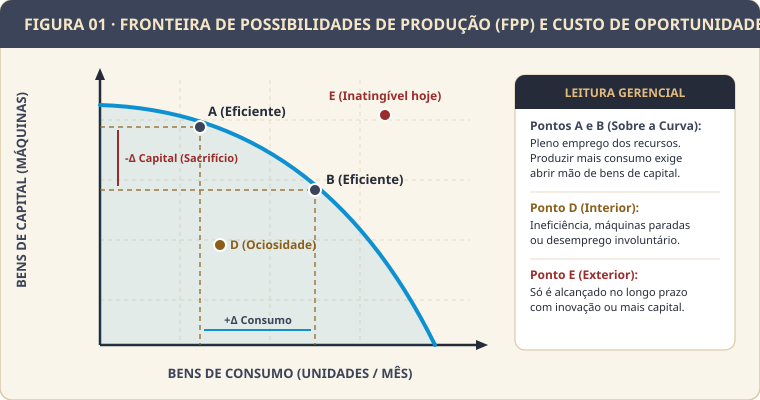
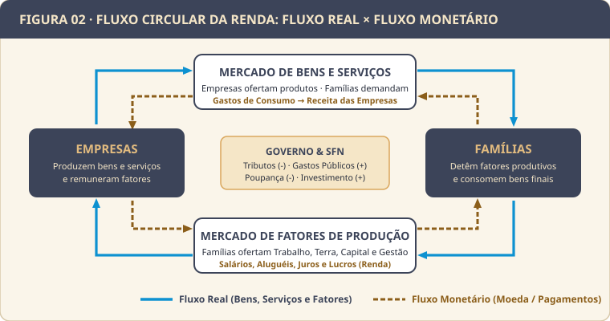

# 01 · Fundamentos da Ciência Econômica, Escassez e Fluxo Circular

[BENTO_INICIO]
- **Trilha Etária:** Técnico Modular · Jovens Adultos (19 a 21 anos)
- **Competência (Bloom):** Analisar a escassez de recursos, calcular o custo de oportunidade e mapear o fluxo circular da renda em decisões empresariais.
- **Carga Horária:** 5 horas-aula · 2 encontros de 150 min (Aulas 01 e 02)
- **Entregável de Portfólio:** Matriz de Custo de Oportunidade e Mapeamento de Fluxo Financeiro Departamental
[BENTO_FIM]

## 1. O Desafio de Pedro (Assistente Júnior — 20 anos)

Pedro tem 20 anos, atua como assistente administrativo-financeiro em uma indústria e distribuidora regional de embalagens e cursa o Técnico em Administração no período noturno. Na segunda-feira pela manhã, a diretoria comercial solicitou o desvio urgente de **20 horas-máquina por semana** da linha de **caixas de papelão padrão** — que gera margem líquida unitária de **R$ 45,00 por milheiro** e produz **10 milheiros por hora** — para atender a um pedido extraordinário de **500 lotes de rótulos especiais**, ofertado com lucro líquido total de **R$ 7.500,00**. O supervisor de vendas argumentou que a operação "traria receita nova sem custo extra aparente, pois as máquinas já estão pagas".

Como Pedro demonstra tecnicamente à gerência que toda escolha envolve uma renúncia mensurável — e que essa realocação, à primeira vista vantajosa no faturamento bruto, pode destruir valor econômico real se o **custo de oportunidade** superar o ganho proposto?

---

## 2. Construindo o Conhecimento

### 2.1 Objeto da Economia, Escassez e Problemas Fundamentais (Aula 01)

A palavra **Economia** origina-se do grego *oikonomia* — junção de *oikos* (casa, patrimônio, unidade produtiva) e *nomos* (norma, lei, administração). Ao longo do desenvolvimento científico moderno, consolidou-se como a **ciência social aplicada que estuda como indivíduos, empresas e sociedades escolhem alocar recursos produtivos escassos na produção de bens e serviços para atender a necessidades humanas potencialmente ilimitadas** (SANDRONI, 2000; MOCHRIE, 2025).

Observe que a economia não nasce da abundância, mas da **escassez**. Necessidades biológicas (alimentação, água, abrigo), sociais (educação, transporte, comunicação) e empresariais (energia, capital de giro, horas técnicas, armazenagem) renovam-se continuamente e superam a capacidade finita de matérias-primas, mão de obra qualificada, equipamentos e tempo disponíveis em cada período. Por isso, todo gestor administrativo lida diariamente com *trade-offs*: priorizar um projeto, um turno ou uma linha de produto implica necessariamente abrir mão de outra alternativa viável.

> 📖 **GLOSSÁRIO**
> **Escassez Econômica:** descompasso permanente entre necessidades humanas e empresariais ilimitadas e a disponibilidade finita de recursos produtivos em dado momento.
> **Custo de Oportunidade:** valor econômico líquido da melhor alternativa produtiva ou financeira sacrificada no instante em que você escolhe outra opção.

Diante da escassez, qualquer organização ou sistema econômico precisa responder simultaneamente a **três problemas econômicos fundamentais**:

1. **O quê e quanto produzir:** diante de orçamento e horas-máquina limitados, definir quais bens ou serviços entregar e em qual volume para atender à demanda solvável do mercado.
2. **Como produzir:** selecionar a combinação tecnológica e operacional mais eficiente (intensiva em mão de obra, automatizada ou terceirizada) buscando o menor custo unitário sem comprometer o padrão de qualidade exigido.
3. **Para quem produzir:** definir o público comprador, os canais de distribuição e a forma como a renda gerada será repartida entre trabalhadores, fornecedores de insumos, financiadores, Estado (tributos) e sócios.

Para executar essas respostas, a empresa combina os **fatores de produção** disponíveis, cada qual com uma remuneração econômica específica no mercado:

[DIAGRAMADOR: EXIBIR TABELA ABAIXO COM TIPOGRAFIA TABULAR E DESTAQUE ESTRUTURAL ARQUITETURA FIDUCIÁRIA]

| Fator de Produção | Papel no Processo Produtivo | Remuneração Econômica | Exemplo na Administração |
| :--- | :--- | :--- | :--- |
| **Trabalho** | Esforço físico e intelectual humano | **Salário** (e encargos) | Folha de analistas, operadores e vendedores |
| **Terra / Recursos Naturais** | Solo, água, energia bruta, jazidas, localização | **Aluguel / Renda** | Locação de galpão industrial ou área agrícola |
| **Capital** | Máquinas, frotas, instalações, capital financeiro | **Juro** | Financiamento de frota, equipamentos ou giro |
| **Tecnologia e Conhecimento** | Patentes, softwares, métodos e P&D | **Royalties / Licenças** | Licença de sistema ERP ou patente industrial |
| **Capacidade Empresarial** | Coordenação dos demais fatores sob risco | **Lucro** | Resultado líquido que remunera os sócios |

### 2.2 Fronteira de Possibilidades de Produção (FPP) e Custo de Oportunidade

A ferramenta gráfica clássica para visualizar escassez, eficiência e renúncia chama-se **Fronteira de Possibilidades de Produção (FPP)**. Ela representa o limite máximo de combinações de dois bens (ou linhas produtivas) que uma economia ou fábrica consegue entregar utilizando **100% dos seus fatores produtivos com a melhor tecnologia disponível**.

Analise os quatro cenários representados na **Figura 01**:
- **Pontos A e B (sobre a curva):** representam **eficiência produtiva plena**. Não há desperdício nem ociosidade. Para deslocar a produção de A para B (ampliando bens de consumo), a organização precisa sacrificar unidades de bens de capital.
- **Ponto D (interior da curva):** retrata **capacidade ociosa ou ineficiência operacional** (equipamentos parados, retrabalho, absenteísmo ou desemprego de fatores). É possível aumentar a produção de uma linha sem reduzir a outra apenas corrigindo gargalos de gestão.
- **Ponto E (exterior à curva):** é **inatingível no curto prazo** com a estrutura e tecnologia atuais. Alcançá-lo no médio ou longo prazo exige **acumulação de capital** (novas máquinas), capacitação da equipe ou **inovação tecnológica** — movimento que desloca toda a FPP para fora.

> ⚠️ **ATENÇÃO**
> Nunca confunda **custo contábil explícito** (nota fiscal paga no caixa) com **custo econômico total**. Na tomada de decisão gerencial, o custo econômico soma os desembolsos explícitos ao **custo de oportunidade** do recurso próprio alocado (como tempo de máquina desviado de outra linha lucrativa ou capital dos sócios que poderia render juros em aplicação livre de risco).

> 🛠️ **PARA PRATICAR**
> Imagine uma gráfica rápida com 40 horas semanais de impressora industrial. Em 1 hora, ela imprime ou **500 catálogos** ou **2.000 panfletos**. Calcule quantos catálogos são sacrificados ao aceitar uma encomenda urgente de 8.000 panfletos estando com a máquina em capacidade cheia. *(Dica: apure primeiro quantas horas o pedido consome.)*

### 2.3 Sistemas Econômicos e Organização Institucional (Aula 02)

Cada sociedade cria regras jurídicas, instituições e mecanismos de coordenação para responder aos três problemas fundamentais: esses arranjos denominam-se **sistemas econômicos** (GONÇALVES et al., 2019). Na prática histórica e contemporânea, você encontrará três matrizes conceituais principais:

1. **Economia de Mercado (Descentralizada):** fundamentada na propriedade privada dos fatores de produção e na livre iniciativa. Quem coordena *"o quê, como e para quem"* é o **sistema de preços** gerado pela interação entre oferta e demanda. A atuação estatal concentra-se na garantia de contratos, segurança jurídica e infraestrutura básica.
2. **Economia Planificada (Centralizada):** os meios produtivos pertencem predominantemente ao Estado, e um órgão central de planejamento define metas físicas de produção, preços e cotas de distribuição. Historicamente revelou rigidez de informação, baixa inovação no varejo e desabastecimentos frequentes.
3. **Economia Mista (Padrão Contemporâneo):** reúne iniciativa privada atuando pelo mecanismo de preços — motor central de eficiência e inovação — com regulação, tributação, defesa da concorrência e provisão de serviços públicos essenciais pelo Estado (educação, saúde, saneamento, política monetária e infraestrutura).

Para o técnico em Administração, compreender esse arranjo misto tem aplicação imediata: sua empresa decide preços, contratações e investimentos em mercados competitivos, mas planeja obrigatoriamente considerando regras fiscais, normas trabalhistas, taxas de juros definidas pela autoridade monetária e regulações setoriais.

> ❓ **REFLITA**
> Por que países com elevada insegurança jurídica ou burocracia excessiva costumam apresentar menor taxa de investimento privado mesmo quando possuem abundância de recursos naturais?

### 2.4 Fluxo Circular da Renda: Fluxo Real e Fluxo Monetário

Para enxergar como famílias e empresas dependem reciprocamente umas das outras dentro de uma economia mista, economistas utilizam o modelo do **Fluxo Circular da Renda**. Ele integra dois mercados fundamentais: o **Mercado de Bens e Serviços** e o **Mercado de Fatores de Produção**.

Acompanhe atentamente os dois sentidos opostos ilustrados na **Figura 02**:
- **Fluxo Real (setas contínuas azuis):** mostra o movimento físico e tangível de recursos e produtos. As **famílias** fornecem trabalho, terra, capital e capacidade empreendedora no mercado de fatores; as **empresas** combinam esses fatores para produzir bens e serviços e os entregam às famílias no mercado de bens.
- **Fluxo Monetário (setas tracejadas douradas):** registra a contrapartida financeira em moeda que viabiliza as trocas sem escambo. As **empresas** pagam salários, aluguéis, juros e lucros às famílias; com essa renda, as **famílias** pagam pelos bens e serviços adquiridos, gerando o **faturamento das empresas**.

Na economia real brasileira, dois agentes ampliam esse circuito básico: o **Governo** (que arrecada tributos — vazamento parcial do fluxo privado — e os reinjeta como compras públicas, obras e transferências de renda) e o **Sistema Financeiro Nacional** (que capta a poupança das famílias superavitárias e a direciona como crédito produtivo para investimento das empresas), além das **exportações e importações** com o resto do mundo.

Considere um exemplo quantitativo de circuito simplificado em um município de médio porte: suponha que empresas locais remunerem fatores de produção das famílias em **R$ 180.000,00** no mês. Desse total, as famílias gastam **R$ 150.000,00** no comércio e serviços da cidade e poupam ou recolhem **R$ 30.000,00**. Para que o faturamento total das empresas continue estável em R$ 180.000,00 no ciclo seguinte, esses R$ 30.000,00 precisam retornar à economia na forma de **investimentos produtivos** (ampliação de estoque/máquinas) ou **gastos públicos locais**. Quando o crédito encarece e os investimentos recuam, o faturamento do varejo desacelera em cadeia.

> 💡 **SAIBA MAIS**
> Micro e pequenas empresas exercem papel decisivo na sustentação desse fluxo circular no Brasil: levantamentos institucionais do Sebrae apontam que os pequenos negócios respondem por cerca de **26,5% do PIB nacional**, representam mais de **95% das empresas ativas** e concentraram **80,5% do saldo de contratações formais** registradas em 2025, alimentando diretamente a massa salarial consumida no mercado interno (AGÊNCIA SEBRAE DE NOTÍCIAS, 2025a, 2025b).

> 🧭 **PARA REFLETIR**
> Quando uma grande fábrica local atrasa salários ou demite 15% do quadro, por que padarias, farmácias e mercados do bairro sentem queda de movimento na mesma semana? Conecte sua resposta ao conceito de fluxo monetário.

> 🎬 **MÍDIAS INTEGRADAS**
> Acesse as aulas interativas locais desta disciplina em **`html/aula-01.html`** (Simulador de Fronteira de Possibilidades de Produção e Custo de Oportunidade) e **`html/aula-02.html`** (Laboratório Interativo do Fluxo Circular Real × Monetário) para testar deslocamentos produtivos e vazamentos de renda ao vivo.

---

## 3. Síntese — Pedro em Ação

> 🚀 **SÍNTESE — PEDRO EM AÇÃO**
> Pedro aplicou diretamente os conceitos de **escassez** e **custo de oportunidade** ao pedido da equipe comercial:
> 1. **Produção sacrificada:** ao desviar **20 horas-máquina semanais** da linha de caixas padrão (`10 milheiros/hora`), a fábrica deixaria de produzir **`20 × 10 = 200 milheiros`** na semana.
> 2. **Custo de oportunidade líquido:** multiplicando os 200 milheiros sacrificados pela margem líquida de **R$ 45,00/milheiro**, a empresa renunciaria a **`200 × R$ 45,00 = R$ 9.000,00`** de resultado real.
> 3. **Comparação econômica objetiva:** o pedido dos rótulos especiais pagaria **R$ 7.500,00** — portanto, geraria **prejuízo econômico de R$ 1.500,00** (`R$ 7.500,00 − R$ 9.000,00`) frente à operação padrão!
> Pedro apresentou o quadro comparativo à gerência demonstrando que aceitar os rótulos só faria sentido se o cliente pagasse margem superior a **R$ 9.000,00** ou se o lote fosse executado em turno ocioso (ponto D da FPP, sem deslocar caixas padrão).

---

## 4. Desafio de Portfólio Profissional

Desenvolva seu primeiro relatório econômico curto seguindo estas etapas:
1. **Identifique** na sua rotina de trabalho (ou em uma empresa comercial da sua região) uma decisão recente que envolveu uso alternativo de tempo, espaço de loja, verba ou equipe.
2. **Calcule** o **custo de oportunidade** em reais ou horas produtivas dessa escolha, explicitando qual alternativa ficou em segundo lugar.
3. **Esquematize** em até 8 linhas como essa empresa participa simultaneamente do **fluxo real** e do **fluxo monetário** com clientes e trabalhadores locais.
4. **Resolva** os exercícios propostos em [`exercícios/L01-fundamentos-economia-e-escassez.md`](../exercícios/L01-fundamentos-economia-e-escassez.md) e inicie a leitura do caso [`estudo-de-caso/EC01-escassez-e-planejamento-produtivo.md`](../estudo-de-caso/EC01-escassez-e-planejamento-produtivo.md).

[PROFESSOR_INICIO]
Orientação docente (Aulas 01 e 02 — 150 min cada):
- Na Aula 01, explore a diferença entre "custo que aparece no boleto" (contábil) e "resultado que deixou de entrar" (econômico/oportunidade). Peça aos alunos da trilha 19–21 que tragam exemplos reais de horas extras, deslocamentos de equipe ou aluguel de galpão próprio.
- Na Aula 02, utilize `html/aula-02.html` no projetor para simular um choque de demissão industrial vs. injeção de crédito produtivo e peça que identifiquem quais linhas de Famílias, Empresas, Governo e Bancos piscam primeiro.
- Respostas de referência da atividade rápida "Para Praticar": `8.000 panfletos ÷ 2.000 panfletos/h = 4 horas`; sacrifício de `4 h × 500 catálogos/h = 2.000 catálogos`.
[PROFESSOR_FIM]

---

## 5. Referências

AGÊNCIA SEBRAE DE NOTÍCIAS. **Pequenos negócios somam 24 milhões de empresas ativas**. Brasília: Sebrae, 2025a. Disponível em: https://agenciasebrae.com.br/dados/pequenos-negocios-somam-24-milhoes-de-empresas-ativas/. Acesso em: 15 nov. 2026.

AGÊNCIA SEBRAE DE NOTÍCIAS. **Micro e pequenas empresas são alavanca no resultado da menor taxa de desemprego do país**. Brasília: Sebrae, 2025b. Disponível em: https://agenciasebrae.com.br/dados/micro-e-pequenas-empresas-sao-alavanca-no-resultado-da-menor-taxa-de-desemprego-do-pais/. Acesso em: 15 nov. 2026.

GONÇALVES, Robson Ribeiro et al. **Cenários econômicos e tendências**. Rio de Janeiro: Editora FGV, 2019.

MOCHRIE, Robbie. **Como pensar como um economista**. São Paulo: Astral Cultural, 2025.

SANDRONI, Paulo. **Traduzindo o economês**: para entender a economia brasileira na época da globalização. São Paulo: Best Seller, 2000.

---
[← Índice da Disciplina](../README.md) · [Próximo: 02 · Microeconomia e Teoria do Consumidor →](02-microeconomia-e-teoria-do-consumidor.md)
