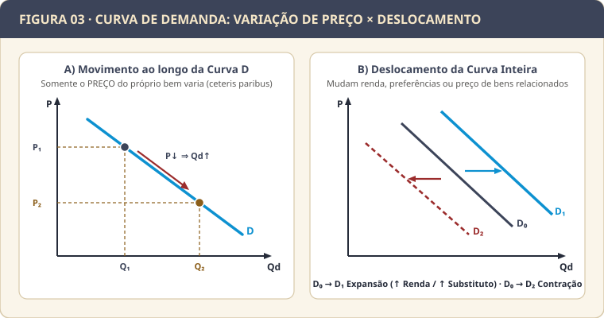

# 02 · Microeconomia: Agentes Econômicos, Teoria do Consumidor e Demanda

[BENTO_INICIO]
- **Trilha Etária:** Técnico Modular · Jovens Adultos (19 a 21 anos)
- **Competência (Bloom):** Diferenciar variações na quantidade demandada de deslocamentos da curva de demanda, avaliando impacto da renda e de bens relacionados sobre as vendas.
- **Carga Horária:** 5 horas-aula · 2 encontros de 150 min (Aulas 03 e 04)
- **Entregável de Portfólio:** Diagnóstico de Comportamento de Demanda e Classificação de Portfólio de Produtos
[BENTO_FIM]

## 1. O Desafio de Pedro (Assistente Júnior — 20 anos)

Pedro agora participa do comitê comercial de uma **rede atacadista e varejista regional de alimentos e itens básicos**. Nos últimos três meses, os gerentes de loja observaram um fenômeno aparentemente contraditório: mesmo sem alteração no preço de venda do **arroz tipo 1 de 5 kg (mantido a R$ 28,00)**, o volume mensal caiu 9% em uma unidade e cresceu 14% em outra; ao mesmo tempo, o reajuste forte no preço do **café torrado** reduziu a saída de **filtros descartáveis de papel**, embora os filtros não tenham sofrido aumento de preço.

Como Pedro utiliza os instrumentos da **Microeconomia** e da **Teoria do Consumidor** para explicar à diretoria comercial por que preços estáveis ainda provocam oscilações intensas no volume vendido — evitando campanhas de desconto ineficazes?

---

## 2. Construindo o Conhecimento

### 2.1 Escopo da Microeconomia, *Ceteris Paribus* e Escolha do Consumidor (Aula 03)

A Ciência Econômica divide-se tradicionalmente em dois grandes campos complementares desde a década de 1930: a **Microeconomia** e a **Macroeconomia**. Enquanto a Macroeconomia observa os grandes agregados nacionais (PIB, nível geral de preços, taxa de juros básica e desemprego agregado), a **Microeconomia — também conhecida como Teoria dos Preços — analisa a conduta individual dos agentes econômicos**: consumidores, trabalhadores, proprietários de recursos e firmas atuando em mercados específicos (VASCONCELLOS; GARCIA, 2016; PINDYCK; RUBINFELD, 2013).

Para isolar o efeito de uma variável econômica por vez sem confundir o raciocínio com dezenas de fatores mudando simultaneamente, a Microeconomia adota a hipótese metodológica do ***ceteris paribus*** (expressão latina que significa *"mantendo todas as outras condições constantes"*). Quando você analisa como uma redução de 10% no preço do pão afeta a procura semanal da padaria, você pressupõe *ceteris paribus* que a renda dos clientes, o preço da manteiga e os hábitos alimentares do bairro não se alteraram naquela mesma semana.

> 📖 **GLOSSÁRIO**
> ***Ceteris Paribus*:** hipótese analítica que mantém constantes todas as demais variáveis explicativas para medir o impacto isolado de uma única mudança de preço, custo ou renda.
> **Utilidade:** grau subjetivo de satisfação, bem-estar ou resolução de necessidade que um consumidor extrai ao adquirir e utilizar determinado bem ou serviço.

Na base da **Teoria do Consumidor**, cada pessoa ou família toma decisões combinando dois elementos objetivos e subjetivos:
1. **Preferências e Utilidade Marginal:** os consumidores ordenam escolhas de acordo com suas preferências e cultura de consumo. Em regra, aplica-se a **Lei da Utilidade Marginal Decrescente**: cada unidade adicional consumida de um mesmo bem em curto intervalo entrega satisfação menor do que a anterior (o primeiro copo de água após correr traz altíssima utilidade; o quarto copo traz utilidade residual próxima de zero).
2. **Restrição Orçamentária:** desejos são amplos, porém o orçamento mensal (`R`) é limitado. Se uma família reserva **R$ 600,00/mês** para adquirir duas categorias de itens — cafés especiais a **P₁ = R$ 20,00** e kits de higiene a **P₂ = R$ 30,00** —, toda cesta viável precisa obedecer à equação:

`R = P₁ · Q₁ + P₂ · Q₂  ⇒  600 = 20 · Q₁ + 30 · Q₂`

Analise as escolhas possíveis nessa restrição:
- Se destinar 100% ao item 1 (`Q₂ = 0`), compra no máximo **`600 ÷ 20 = 30 unidades`** de café.
- Se destinar 100% ao item 2 (`Q₁ = 0`), compra no máximo **`600 ÷ 30 = 20 kits`**.
- Uma cesta equilibrada seria **`Q₁ = 15`** e **`Q₂ = 10`**, pois **`15 × R$ 20,00 + 10 × R$ 30,00 = R$ 300,00 + R$ 300,00 = R$ 600,00`**.
- Observe o poder de decisão gerencial dessa equação: se o preço do café cai para **R$ 15,00** (*ceteris paribus*), o poder aquisitivo máximo em café salta para **`600 ÷ 15 = 40 unidades`**, rotacionando a reta orçamentária para fora e liberando renda real para outros produtos da loja.

### 2.2 Lei da Demanda, Curva Individual e Demanda de Mercado

Chamamos de **Demanda (ou Procura)** a quantidade de determinado bem ou serviço que os consumidores **desejam e possuem capacidade financeira para adquirir** em um intervalo de tempo específico. Desejo sem poder de compra é apenas vontade psicológica; demanda efetiva exige renda disponível disposta a pagar pelo preço vigente.

Mantidas todas as demais variáveis constantes (*ceteris paribus*), vigora a **Lei Geral da Demanda**: **quanto maior o preço de um bem ou serviço, menor tende a ser a quantidade demandada desse bem; e quanto menor o preço, maior será a quantidade procurada**. Dois mecanismos econômicos explicam essa relação inversa:
- **Efeito Substituição:** quando um produto fica relativamente mais caro que concorrentes próximos, consumidores migram parte das compras para alternativas mais baratas.
- **Efeito Renda:** quando o preço de um item relevante sobe sem reajuste salarial proporcional, o poder de compra real da família encolhe, obrigando redução física da cesta adquirida.

Em termos matemáticos e comerciais, considere uma função linear simplificada de demanda mensal de café em uma loja de bairro:

`Qd = 500 − 10P`

Se o pacote custa **R$ 20,00**, a loja projeta **`Qd = 500 − 10(20) = 300 pacotes/mês`**. Caso promova uma ação promocional baixando para **R$ 15,00**, a quantidade procurada sobe para **`Qd = 500 − 10(15) = 350 pacotes/mês`**. A soma horizontal das curvas de todos os consumidores da região (Consumidor A + Consumidor B + ... + Consumidor N em cada nível de preço) origina a **Demanda de Mercado**, objeto central da previsão de faturamento de uma empresa.

> ⚠️ **ATENÇÃO**
> Nunca use *"variação da demanda"* e *"variação da quantidade demandada"* como sinônimos em relatórios administrativos! Quando apenas o **preço do próprio produto** muda, ocorre um **movimento ao longo da curva existente** (variação na *quantidade demandada*). Quando muda a renda, os gostos ou o preço de outro produto, **a curva inteira muda de posição** (deslocamento da *demanda*).

### 2.3 Determinantes dos Deslocamentos da Curva de Demanda (Aula 04)

Em sala e no planejamento comercial, você precisa saber exatamente o que desloca toda a curva para a direita (**expansão da demanda**, vendendo mais pelo mesmo preço) ou para a esquerda (**contração da demanda**, vendendo menos mesmo sem subir preço).

Observe os quatro principais deslocadores representados no Painel B da **Figura 03**:

1. **Renda do Consumidor:** a reação ao aumento da renda média classifica os bens em três grupos estratégicos para o mix de loja:
   - **Bens Normais:** a demanda cresce quando a renda aumenta e recua quando a renda cai (ex.: laticínios selecionados, vestuário, serviços educacionais).
   - **Bens Superiores (ou de Luxo):** ao aumentar a renda, o consumo cresce em **proporção maior** que o ganho salarial (ex.: viagens, eletrônicos de ponta, gastronomia especializada).
   - **Bens Inferiores:** ao crescer a renda familiar, o consumidor reduz a compra para migrar a opções consideradas de maior qualidade (ex.: corte de carne de terceira substituído por cortes mais macios; transporte coletivo longo substituído por veículo próprio).

2. **Preços dos Bens Relacionados:**
   - **Bens Substitutos:** atendem à mesma necessidade básica em concorrência direta (ex.: etanol vs. gasolina; manteiga vs. margarina; carne bovina vs. frango). **Alta no preço do substituto desloca a demanda do seu produto para a direita.**
   - **Bens Complementares:** são consumidos em conjunto para gerar utilidade (ex.: café em pó e filtro de papel; impressora e cartucho; carro e seguro/combustível). **Alta no preço do complementar desloca a demanda do seu produto para a esquerda.**

3. **Gostos, Preferências, Cultura e Sazonalidade:** mudanças etárias, tendências de saúde, restrições alimentares, clima sazonal (sorvete no verão, chocolate na Páscoa) e reputação da marca alteram diretamente a disposição a comprar em qualquer faixa de preço.

4. **Expectativas sobre Preços e Renda Futuros:** se consumidores acreditam que um imposto elevará o preço de eletrodomésticos no próximo mês ou temem desemprego no setor local, antecipam ou adiam compras imediatamente hoje.

[DIAGRAMADOR: QUADRO-RESUMO COMPARATIVO COM BORDAS SUTIS PARA CONSULTA RÁPIDA DE GESTÃO]

| Evento no Ambiente de Mercado (*Ceteris Paribus*) | Categoria Envolvida | Efeito na Curva de Demanda do Seu Produto |
| :--- | :--- | :--- |
| Aumento da renda média em região industrial | Produto é **Bem Normal** | Deslocamento para a **Direita (D₀ → D₁)** |
| Aumento da renda média em região industrial | Produto é **Bem Inferior** | Deslocamento para a **Esquerda (D₀ → D₂)** |
| Concorrente direto (**Bem Substituto**) fica 25% mais caro | Substituição de consumo | Deslocamento para a **Direita (D₀ → D₁)** |
| Item usado junto (**Bem Complementar**) dobra de preço | Consumo conjunto | Deslocamento para a **Esquerda (D₀ → D₂)** |
| Promoção exclusiva no **preço do próprio produto** | Variável endógena | **Não desloca a curva:** move o ponto ao longo de D₀ |

### 2.4 Previsão Comercial Aplicada e Consumo Real no Brasil

Na administração de varejo, compras e marketing, classificar o portfólio por essas categorias evita erros caros de estoque. Em momentos de desaceleração da renda ou alta da inflação de serviços, supermercados ampliam a gôndola de embalagens econômicas e marcas próprias (**efeito substituição e bens inferiores**), enquanto empresas de bens duráveis ajustam parcelas porque dependem de expectativas e crédito.

> ❓ **REFLITA**
> Se uma montadora percebe queda na taxa de juros do financiamento automotivo, o que tende a acontecer com a demanda por pneus e seguros automotivos no trimestre seguinte — e qual categoria econômica explica esse movimento?

> 💡 **SAIBA MAIS**
> Estudos oficiais do IBGE sobre o comportamento do IPCA em **2024** revelaram um caso emblemático de demanda relacionada e choque de preços: diante da alta de **39,60%** acumulada no preço do café moído em 2024 (IBGE, 2025), varejistas e indústrias registraram migração de parte dos consumidores para marcas intermediárias, blends mais econômicos e bebidas substitutas, alterando o mix de pedidos das redes distribuidoras.

> 🏙️ **CENÁRIO DA SOCIABILIDADE COTIDIANA**
> Imagine um aplicativo de entregas urbanas em noite de chuva intensa na saída do trabalho. A quantidade de usuários solicitando corrida e refeições cresce abruptamente, enquanto parte dos entregadores evita sair sob temporal. Mesmo sem mudança de gosto permanente, ocorre simultaneamente deslocamento da demanda para a direita no horário de pico.

> 🎬 **MÍDIAS INTEGRADAS**
> Abra **`html/aula-03.html`** (Simulador de Restrição Orçamentária: altere renda e preços de dois bens para visualizar a rotação da reta) e **`html/aula-04.html`** (Laboratório Gráfico da Curva de Demanda: acione choques de renda, bem substituto e bem complementar e observe `D₀ → D₁ / D₂` em tempo real).

---

## 3. Síntese — Pedro em Ação

> 🚀 **SÍNTESE — PEDRO EM AÇÃO**
> Pedro resolveu o aparente paradoxo das lojas apresentando dois diagnósticos objetivos baseados na **Teoria da Demanda**:
> 1. **Arroz tipo 1 estável com queda em uma loja e alta em outra:** como o preço próprio permaneceu inalterado em **R$ 28,00**, não houve variação ao longo da curva, mas **deslocamentos opostos causados por renda e substituição local** — na filial onde houve fechamento de turno industrial (queda de renda local), parte dos clientes migrou para pacotes de arroz tipo 2 ou marcas econômicas (**bens substitutos**); na filial próxima a um bairro em expansão com nova obra geradora de massa salarial, a demanda pelo arroz tipo 1 (**bem normal**) deslocou-se para a **direita (`+14%`)**.
> 2. **Queda nos filtros de papel:** filtros e café em pó são **bens complementares perfeitos no preparo doméstico**. A escalada no preço do café reduziu a quantidade demandada de café e deslocou para a **esquerda** toda a curva de demanda de filtros — provando que fazer "promoção agressiva isolada de filtro" não resolveria a causa raiz, sendo mais inteligente montar kits combinados de filtro + café econômico para preservar margem.

---

## 4. Desafio de Portfólio Profissional

Prepare um memorando comercial de 1 página para o seu portfólio de Gestão:
1. **Escolha** uma empresa do seu setor ou bairro (farmácia, oficina, papelaria, padaria, academia ou e-commerce) e selecione **1 produto principal**.
2. **Mapeie** pelo menos **1 bem substituto direto** e **1 bem complementar** desse produto na mesma loja.
3. **Projete** como a curva de demanda (`D₀`) do produto principal se deslocaria em dois cenários distintos: *(a)* queda de 15% na renda disponível dos clientes da região e *(b)* aumento de 30% no preço do bem substituto.
4. **Conclua** os exercícios em [`exercícios/L02-microeconomia-e-teoria-do-consumidor.md`](../exercícios/L02-microeconomia-e-teoria-do-consumidor.md).

[PROFESSOR_INICIO]
Orientação docente (Aulas 03 e 04 — 150 min cada):
- Reforce visualmente com `html/aula-03.html` que "cair preço" gira a reta orçamentária em torno de um intercepto fixo, ao passo que "aumentar a renda" desloca toda a reta paralelamente para fora.
- Na Aula 04, evite que os alunos memorizem tabelas mecanicamente: faça uma roda rápida pedindo pares "substituto × complementar" ligados ao emprego atual deles (ex.: frete rodoviário × diesel; assinatura streaming × pipoca/smart TV; marmita × restaurante por quilo).
[PROFESSOR_FIM]

---

## 5. Referências

INSTITUTO BRASILEIRO DE GEOGRAFIA E ESTATÍSTICA (IBGE). **IPCA fecha 2024 em 4,83% pressionado por alimentação e bebidas**. Rio de Janeiro: Agência de Notícias IBGE, 2025. Disponível em: https://agenciadenoticias.ibge.gov.br/agencia-noticias.html. Acesso em: 15 nov. 2026.

MOCHRIE, Robbie. **Como pensar como um economista**. São Paulo: Astral Cultural, 2025.

PINDYCK, Robert S.; RUBINFELD, Daniel L. **Microeconomia**. 8. ed. São Paulo: Pearson, 2013.

VARIAN, Hal R. **Microeconomia**: uma abordagem moderna. 9. ed. Rio de Janeiro: Elsevier, 2015.

VASCONCELLOS, Marco Antônio Sandoval de; GARCIA, Manuel Enriquez. **Fundamentos de economia**. 6. ed. São Paulo: Saraiva, 2016.

---
[← 01 · Fundamentos da Ciência Econômica](01-fundamentos-economia-e-escassez.md) · [Próximo: 03 · Teoria da Firma, Custos e Oferta →](03-teoria-da-firma-custos-e-oferta.md)
