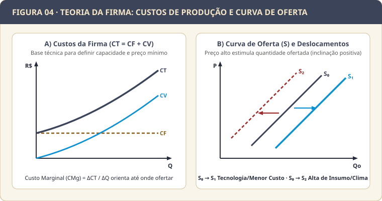

# 03 · Teoria da Firma: Produção, Custos Econômicos e Oferta de Mercado

[BENTO_INICIO]
- **Trilha Etária:** Técnico Modular · Jovens Adultos (19 a 21 anos)
- **Competência (Bloom):** Calcular produtividade marginal, custo médio e custo marginal na decisão de oferta da empresa e diagnosticar choques produtivos na curva de oferta.
- **Carga Horária:** 5 horas-aula · 2 encontros de 150 min (Aulas 05 e 06)
- **Entregável de Portfólio:** Parecer de Aceitação de Lote Adicional com Cálculo de Custo Marginal
[BENTO_FIM]

## 1. O Desafio de Pedro (Assistente Júnior — 20 anos)

Pedro presta apoio financeiro em uma **fábrica regional de móveis modulares para escritórios**. Atualmente, a planta opera com **100 estações de trabalho por mês**, apresentando **Custo Fixo (CF) de R$ 18.000,00/mês** (aluguel do galpão, depreciação das máquinas e salários administrativos) e **Custo Variável (CV) de R$ 220,00 por estação**, totalizando **Custo Total de R$ 40.000,00** — ou seja, **Custo Médio (CMe) de R$ 400,00 por unidade**.

Na sexta-feira, um cliente corporativo propôs comprar um lote extra de **20 estações adicionais** no mês pelo preço fechado de **R$ 330,00 cada**. Para entregar essas 20 peças extras dentro do mesmo galpão sem ampliar o aluguel, a fábrica precisará pagar horas extras elevando o custo variável apenas desse lote adicional para **R$ 280,00 por unidade**. O gerente de produção vetou o negócio de imediato dizendo: *"Nosso custo médio é R$ 400,00; vender a R$ 330,00 gera prejuízo garantido de R$ 70,00 por mesa!"*

Será mesmo? Como Pedro utiliza o conceito microeconômico de **Custo Marginal** e **Teoria da Firma** para provar matematicamente se esse pedido adicional gera prejuízo ou aumenta o lucro mensal da fábrica?

---

## 2. Construindo o Conhecimento

### 2.1 Função de Produção e Rendimentos Marginais Decrescentes (Aula 05)

A **Teoria da Firma** investiga como as organizações combinam fatores de produção (*inputs* — trabalho, capital, insumos e tecnologia) para transformá-los em bens e serviços (*outputs*), buscando maximizar o resultado líquido entre receita e custo econômico (CORREA; VARGAS, 2015). Formalmente, essa relação técnica descreve-se pela **Função de Produção**:

`Q = f(K, L, T)`

em que **Q** é a quantidade produzida, **K** representa o capital (máquinas e espaço físico), **L** indica o volume de trabalho e **T** reflete o nível tecnológico. Na análise administrativa, distingue-se o horizonte em dois recortes funcionais — não pelo calendário em meses, mas pela rigidez dos recursos:
- **Curto Prazo:** pelo menos um fator de produção é **fixo** (ex.: o tamanho do galpão e o número de serras CNC já instaladas). Para produzir mais hoje, você altera apenas fatores variáveis (horas de trabalho, insumos, energia de máquina).
- **Longo Prazo:** todos os fatores tornam-se **variáveis** (a empresa consegue construir outro galpão, comprar novas máquinas ou mudar integralmente de tecnologia).

Ao ampliar apenas trabalhadores (**L**) em uma planta fixa (**K** constante) no curto prazo, manifesta-se a clássica **Lei dos Rendimentos Marginais Decrescentes**. Acompanhe na tabela simulada de uma linha de montagem de móveis:

| Trabalhadores (L) | Produto Total (PT, un.) | Produto Médio (PMe = PT ÷ L) | Produto Marginal (PMg = ΔPT ÷ ΔL) | Fase Produtiva |
| :---: | :---: | :---: | :---: | :--- |
| **1** | 10 | 10,0 un./trab. | +10 | Especialização inicial |
| **2** | 24 | 12,0 un./trab. | **+14** | Ganho por divisão de tarefas |
| **3** | 36 | 12,0 un./trab. | +12 | Início de rendimentos decrescentes |
| **4** | 44 | 11,0 un./trab. | +8 | Congestionamento de bancada/máquinas |
| **5** | 48 | 9,6 un./trab. | +4 | Retorno marginal baixo por adição |

> 📖 **GLOSSÁRIO**
> **Produtividade Marginal do Trabalho (PMgL):** acréscimo físico de produção obtido quando se incorpora exatamente uma unidade adicional de trabalho, mantendo constantes capital e tecnologia.
> **Custo Marginal (CMg):** acréscimo no Custo Total gerado pela produção de uma unidade (ou lote unitário) adicional (`ΔCT ÷ ΔQ`).

### 2.2 Estrutura de Custos na Firma: Fixos, Variáveis, Médio e Marginal

A confusão entre **Custo Médio** e **Custo Marginal** é uma das falhas mais caras na formação de preços e na avaliação de capacidade ociosa nas empresas. Para decidir com rigor técnico, separe cada componente:

1. **Custo Fixo Total (CF):** independe do volume produzido dentro da faixa atual de capacidade (aluguel do prédio, IPTU, assinatura fixa de ERP, seguro predial, salários fixos da supervisão). Se a fábrica produzir zero peças no feriado, o aluguel continua devido.
2. **Custo Variável Total (CV):** acompanha diretamente o nível de produção (matéria-prima, embalagem, comissão de venda, frete de entrega, energia consumida na usinagem, horas extras).
3. **Custo Total (CT):** soma dos dois blocos (`CT = CF + CV`).
4. **Custo Médio (CMe = CT ÷ Q):** quanto cada unidade produzida carrega em média contando o rateio dos custos fixos.
5. **Custo Marginal (CMg = ΔCT ÷ ΔQ):** quanto custa fabricar a **próxima unidade adicional**. Como o `CF` não muda no curto prazo até saturar a planta, na margem contam apenas os acréscimos de custo variável.

No Painel A da **Figura 04**, note que a distância vertical entre a curva **CT** e a curva **CV** corresponde exatamente ao bloco constante de **Custo Fixo (CF)**. Em termos decisórios:
- No **comércio**, o custo direto gira em torno da aquisição da mercadoria + frete + tributos recuperáveis/não recuperáveis + embalagem.
- Na **indústria**, envolve matéria-prima + mão de obra direta + custos indiretos de fabricação (CIF).
- Nos **serviços**, concentra-se na hora técnica alocada + insumos descartáveis + estrutura fixa rateada.

Em todos os três setores, a regra microeconômica de ouro para decidir **se vale expandir o volume ofertado** compara sempre **Receita Marginal (RMg, ou preço obtido no lote extra)** contra **Custo Marginal (CMg)**: enquanto **`P ≥ CMg`**, cada peça extra contribui positivamente para pagar custos fixos e ampliar o lucro!

> ⚠️ **ATENÇÃO**
> Nunca utilize o Custo Médio cheio (com rateio fixo embutido) como critério cego para recusar pedidos adicionais quando há capacidade produtiva disponível. Recusar um pedido cujo preço supera o **Custo Marginal** significa desperdiçar margem de contribuição real que ajudaria a amortizar aluguel e folha fixa. (Naturalmente, verifique antes se o preço promocional ao cliente corporativo não canibalizará vendas regulares de tabela!)

> 🛠️ **PARA PRATICAR**
> Uma padaria possui custo fixo diário de R$ 600,00 e produz 300 pães artesanais com custo variável unitário de R$ 2,00 (`CT = R$ 1.200,00`; `CMe = R$ 4,00`). Se um hotel vizinho quiser comprar mais 50 pães hoje pagando **R$ 3,20/unidade** sem exigir novos fornos nem padeiros adicionais (custo variável continua R$ 2,00/un.), qual será o **CMg** desses 50 pães e qual o impacto no lucro do dia?

### 2.3 A Lei da Oferta e a Curva de Oferta de Mercado (Aula 06)

Do lado dos produtores e distribuidores, definimos **Oferta** como a quantidade de um bem ou serviço que as empresas **desejam e possuem condições produtivas de colocar à venda** a cada preço possível em determinado período.

Sob a hipótese *ceteris paribus*, vigora a **Lei Geral da Oferta**: **quanto maior o preço de mercado de um bem, maior tende a ser a quantidade ofertada pelos produtores; quanto menor o preço, menor será a quantidade ofertada**. Por que a curva de oferta apresenta inclinação positiva (ascendente para a direita, como no Painel B da **Figura 04**)?
- **Custo Marginal crescente no curto prazo:** em razão dos rendimentos decrescentes (horas extras caras, turnos noturnos, máquinas antigas reativadas), produzir volumes extras exige preços maiores para compensar o **CMg** crescente.
- **Atratividade comparativa:** preços mais altos em um segmento atraem empresas que antes destinavam suas máquinas e terras a outro produto menos rentável.

Considere uma função linear didática de oferta mensal de camisas em um polo têxtil:

`Qo = −100 + 15P   (para P > 6,67)`

Observe que a **R$ 20,00**, os confeccionistas ofertam **`Qo = −100 + 15(20) = 200 peças`**. Caso o preço suba para **R$ 30,00**, torna-se viável abrir turno extra, elevando a oferta para **`Qo = −100 + 15(30) = 350 peças`**. Tal como na demanda, a **Oferta de Mercado** nasce da soma horizontal das quantidades ofertadas por todas as empresas produtoras daquele setor em cada faixa de preço.

### 2.4 Deslocamentos da Curva de Oferta e Riscos Produtivos

Assim como você aprendeu a diferenciar movimento e deslocamento na demanda, um erro comum de gestão é confundir variação de preço do produto final com mudança nas condições de produção. Quando muda o **preço do próprio bem**, o ponto corre ao longo da mesma curva `S₀`. Quando mudam **custos, tecnologia, clima ou impostos**, toda a curva desloca-se para a **direita (`S₀ → S₁`, expansão da oferta)** ou para a **esquerda (`S₀ → S₂`, contração da oferta)**.

Os quatro grandes vetores de deslocamento da oferta no Brasil são:
1. **Preços dos Insumos e Fatores de Produção:** alta no diesel, energia elétrica, aço, celulose ou salário mínimo real eleva o custo marginal em todos os níveis de produção e desloca a oferta para a **esquerda (`S₀ → S₂`)**.
2. **Tecnologia e Produtividade:** automação, software de roteirização logística ou sementes melhoradas reduzem o custo unitário por peça entregue, deslocando a oferta para a **direita (`S₀ → S₁`)**.
3. **Condições Climáticas e Choques Naturais:** secas severas, geadas ou enchentes na agricultura e na geração hidrelétrica provocam quebras bruscas de oferta, empurrando a curva para a **esquerda** (como observado nos choques de alimentos em 2024 e nas bandeiras tarifárias elétricas em 2025 no Brasil) (IBGE, 2025, 2026).
4. **Expectativas, Tributação e Preço de Outros Bens na Produção:** criação de imposto sobre produção desloca a oferta para a esquerda; expectativa de alta de preço futuro da carne ou soja leva produtores a reter rebanho/estoques hoje, reduzindo a oferta imediata; alta no preço da soja induz agricultores a converter áreas de milho (**substituto na produção**) para soja, contraindo a oferta de milho.

> ❓ **REFLITA**
> Em uma transportadora rodoviária de médio porte, quais dois eventos externos deslocariam a oferta de fretes disponíveis para a esquerda já na semana seguinte sem que o preço da tabela de frete tenha iniciado o movimento?

> 🎬 **MÍDIAS INTEGRADAS**
> Explore **`html/aula-05.html`** (Simulador de Custos da Firma: ajuste CF, CV e volume para ver CMe vs. CMg e validar pedidos extras) e **`html/aula-06.html`** (Laboratório Gráfico da Curva de Oferta: simule choque de insumos, inovação tecnológica e quebra climática em tempo real).

---

## 3. Síntese — Pedro em Ação

> 🚀 **SÍNTESE — PEDRO EM AÇÃO**
> Pedro montou uma planilha comparativa de duas colunas na reunião de sexta-feira e provou por que o gerente de produção quase recusou um excelente negócio:
> 1. **Situação atual (`100 estações/mês`):** `CF = R$ 18.000,00` + `CV = 100 × R$ 220,00 = R$ 22.000,00` ⇒ **`CT = R$ 40.000,00`** (`CMe = R$ 400,00`).
> 2. **Pedido extra (`+20 estações` a R$ 330,00/un.):**
>    - **Receita Adicional (RMg do lote):** `20 × R$ 330,00 = +R$ 6.600,00`.
>    - **Custo Adicional (CMg do lote):** como o galpão e a supervisão fixa já estão pagos no mês, o `CF` permanece **R$ 18.000,00**; entra apenas o custo variável do lote extra: `20 × R$ 280,00 = +R$ 5.600,00` (`CMg = R$ 280,00/un.`).
>    - **Novo Custo Total e Custo Médio:** `CT(120) = R$ 45.600,00` ⇒ **`CMe(120) = R$ 45.600,00 ÷ 120 = R$ 380,00/un.`** (o custo médio da fábrica até caiu!).
> 3. **Resultado econômico líquido no bolso da empresa:** **`+R$ 6.600,00 − R$ 5.600,00 = +R$ 1.000,00`** de lucro extra!
> Com o parecer fundamentado em **Custo Marginal**, a fábrica aceitou o lote sob contrato fechado (sem descontar a tabela dos clientes antigos) e aumentou o resultado do mês em R$ 1.000,00.

---

## 4. Desafio de Portfólio Profissional

Elabore um **Estudo Técnico de Viabilidade Marginal** para o seu portfólio seguindo estes passos:
1. **Levante** os custos aproximados (fixos mensais e variáveis por unidade/atendimento) de um pequeno negócio comercial, industrial ou de prestação de serviços da sua cidade.
2. **Calcule** o **Custo Médio (CMe)** na operação normal atual.
3. **Simule** a entrada de um contrato de volume adicional em horário ocioso cujo preço ofertado seja 15% menor que o CMe, porém superior ao Custo Variável/Marginal do lote. Demonstre em tabela de "Antes × Depois" o impacto real no resultado líquido.
4. **Resolva** a lista [`exercícios/L03-teoria-da-firma-custos-e-oferta.md`](../exercícios/L03-teoria-da-firma-custos-e-oferta.md).

[PROFESSOR_INICIO]
Orientação docente (Aulas 05 e 06 — 150 min cada):
- Use `html/aula-05.html` para desmontar ao vivo o mito gerencial de que "nunca se pode vender abaixo do custo médio". Deixe os alunos descobrirem a regra de ouro: no longo prazo, a receita precisa cobrir CT (`CMe`); no curto prazo e na margem, qualquer lote adicional sem canibalização que pague acima de `CMg` melhora o lucro ou reduz o prejuízo!
- Gabarito do boxe "Para Praticar" (Padaria): o CF de R$ 600,00 não muda para os 50 pães extras; logo `CMg = R$ 2,00/pão` (`50 × R$ 2,00 = R$ 100,00` de custo extra). Como a receita extra é `50 × R$ 3,20 = R$ 160,00`, o lucro diário aumenta em **+R$ 60,00**!
[PROFESSOR_FIM]

---

## 5. Referências

CORREA, Carla Eunice Gomes; VARGAS, Diego Boehlke. **Microeconomia I**. Indaial: UNIASSELVI, 2015.

INSTITUTO BRASILEIRO DE GEOGRAFIA E ESTATÍSTICA (IBGE). **IPCA fecha 2024 em 4,83% pressionado por alimentação e bebidas**. Rio de Janeiro: Agência de Notícias IBGE, 2025. Disponível em: https://agenciadenoticias.ibge.gov.br/agencia-noticias.html. Acesso em: 15 nov. 2026.

INSTITUTO BRASILEIRO DE GEOGRAFIA E ESTATÍSTICA (IBGE). **IPCA em dezembro vai a 0,33% e acumula 4,26% em 2025**. Rio de Janeiro: Agência de Notícias IBGE, 2026. Disponível em: https://agenciadenoticias.ibge.gov.br/agencia-noticias/2012-agencia-de-noticias/noticias/43178-ipca-em-dezembro-vai-a-0-33-e-acumula-4-26-em-2025.html. Acesso em: 15 nov. 2026.

VARIAN, Hal R. **Microeconomia**: uma abordagem moderna. 9. ed. Rio de Janeiro: Elsevier, 2015.

---
[← 02 · Microeconomia e Teoria do Consumidor](02-microeconomia-e-teoria-do-consumidor.md) · [Próximo: 04 · Equilíbrio de Mercado, Elasticidade e Preços →](04-equilibrio-elasticidade-e-precos.md)
