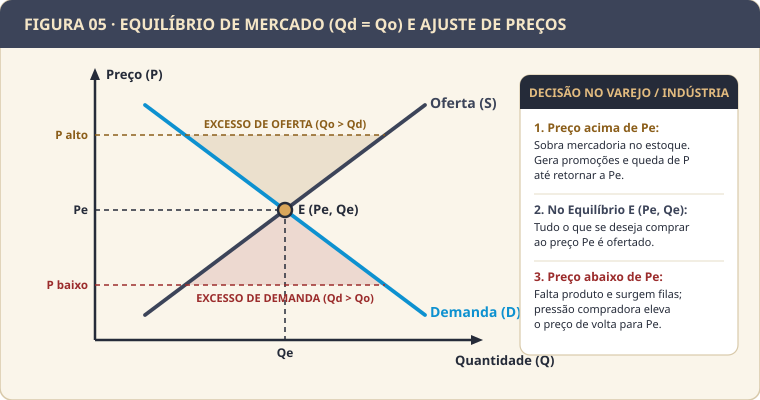

# 04 · Equilíbrio de Mercado, Elasticidade e Dinâmica de Preços

[BENTO_INICIO]
- **Trilha Etária:** Técnico Modular · Jovens Adultos (19 a 21 anos)
- **Competência (Bloom):** Calcular preços e quantidades de equilíbrio de mercado, diagnosticar excessos de oferta/demanda e medir o impacto da elasticidade-preço sobre a receita total.
- **Carga Horária:** 5 horas-aula · 2 encontros de 150 min (Aulas 07 e 08)
- **Entregável de Portfólio:** Matriz de Precificação por Elasticidade e Ajuste de Equilíbrio
[BENTO_FIM]

## 1. O Desafio de Pedro (Assistente Júnior — 20 anos)

Pedro analisa a política comercial de uma **confecção e distribuidora regional de uniformes e moda casual**, que enfrenta dois impasses simultâneos neste trimestre:
1. Na linha de **camisas sociais padrão**, a equipe lançou a coleção a **R$ 90,00** por peça e acumulou dezenas de caixas paradas no estoque; ao avaliar dados históricos, estima-se que a demanda mensal siga **`Qd = 600 − 4P`** e a capacidade de oferta do polo siga **`Qo = −150 + 6P`**.
2. Para acelerar vendas, a gerência propôs um **desconto linear de 20% em todo o catálogo** (baixando o preço de **R$ 100,00 para R$ 80,00**). Contudo, as duas principais linhas têm comportamentos distintos: na **linha casual promocional**, esse desconto eleva as vendas de **500 para 700 peças/mês**; já nos **uniformes técnicos normativos (EPI)** vendidos sob especificação obrigatória para fábricas, o mesmo desconto amplia a demanda apenas de **500 para 530 peças/mês**.

Como Pedro identifica o **preço de equilíbrio** da linha social e demonstra por que o corte linear de 20% aumenta o faturamento em uma linha, mas **destrói receita** na outra?

---

## 2. Construindo o Conhecimento

### 2.1 Equilíbrio de Mercado, Excesso de Oferta e Escassez (Aula 07)

Quando compradores (representados pela curva de Demanda **D**) e vendedores (representados pela curva de Oferta **S**) interagem livremente, os preços funcionam como um termômetro automático de escassez ou abundância. Chamamos de **Equilíbrio de Mercado** a situação exata em que a quantidade que os consumidores desejam comprar iguala a quantidade que as empresas desejam vender ao mesmo preço (`Qd = Qo`), não restando pressão espontânea para o preço subir nem cair (CORREA; VARGAS, 2015).

Observe na **Figura 05** o que acontece fora do ponto **`E(Pe, Qe)`**:

1. **Preço acima do equilíbrio (`P > Pe`) — Excesso de Oferta (Superávit):** os produtores consideram o preço atraente e ofertam grande volume, mas os consumidores retraem compras. Forma-se **excesso de oferta (`Qo > Qd`)**, expresso na prática empresarial por estoques encalhados e alto capital empatado no almoxarifado. Para desovar mercadoria, lojistas promovem queimas de estoque e descontos, empurrando o preço para baixo rumo a **Pe**.
2. **Preço abaixo do equilíbrio (`P < Pe`) — Excesso de Demanda (Escassez):** o preço baixo estimula muitos compradores, mas desestimula produtores com custos marginais maiores. Surge **excesso de demanda (`Qd > Qo`)**, visível em prateleiras vazias, listas de espera e prazos longos de entrega. Consumidores dispostos a pagar mais pressionam o preço para cima rumo a **Pe**.

Acompanhe o cálculo algebricamente com o caso das camisas sociais de Pedro (`Qd = 600 − 4P` e `Qo = −150 + 6P`):

- **Passo 1 — Igualar demanda e oferta (`Qd = Qo`):**
  `600 − 4P = −150 + 6P  ⇒  600 + 150 = 6P + 4P  ⇒  750 = 10P  ⇒` **`Pe = R$ 75,00`**
- **Passo 2 — Encontrar a quantidade de equilíbrio (`Qe`):**
  `Qe = 600 − 4(75) = 600 − 300 =` **`300 unidades`**
  *(Prova real na oferta: `Qo = −150 + 6(75) = −150 + 450 = 300 unidades`.)*
- **Passo 3 — Testar o preço errado de R$ 90,00:**
  - `Qd = 600 − 4(90) = 240` camisas demandadas.
  - `Qo = −150 + 6(90) = 390` camisas ofertadas.
  - Resultado: **Excesso de Oferta = `390 − 240 = 150` camisas paradas por mês**.
- **Passo 4 — Testar um preço abaixo do equilíbrio, R$ 60,00:**
  - `Qd = 600 − 4(60) = 360` camisas demandadas.
  - `Qo = −150 + 6(60) = 210` camisas ofertadas.
  - Resultado: **Excesso de Demanda (falta de produto) = `360 − 210 = 150` unidades**.

> 📖 **GLOSSÁRIO**
> **Preço de Equilíbrio (Pe):** preço no qual os planos de compra dos consumidores coincidem exatamente com os planos de venda das empresas (`Qd = Qo`), zerando sobras de estoque ou filas de escassez.
> **Tarifa Dinâmica:** mecanismo algorítmico em que plataformas digitais (mobilidade urbana, hotelaria, aviação) ajustam o preço em tempo real conforme deslocamentos instantâneos de oferta e demanda para evitar filas ou desabastecimento.

### 2.2 Choques Simultâneos, Controles de Preço e Impostos

Na rotina real de mercado, o equilíbrio nunca fica congelado para sempre: deslocamentos em **D** ou em **S** movem o ponto **E** para um novo patamar:
- **Choque positivo de demanda (ex.: Black Friday ou aumento da renda):** a curva **D** desloca para a direita ⇒ **sobem tanto o preço de equilíbrio quanto a quantidade transacionada**.
- **Choque negativo de oferta (ex.: seca severa ou alta abrupta do diesel):** a curva **S** desloca para a esquerda ⇒ **sobe o preço de equilíbrio e cai a quantidade vendida**.
- **Controles governamentais de preço (teto abaixo de Pe ou piso acima de Pe):** quando uma norma impõe preço máximo artificial abaixo de **Pe**, cria-se escassez crônica, queda de qualidade e mercados paralelos; quando fixa preço mínimo acima de **Pe** sem demanda absorvedora, acumulam-se excedentes que exigem compra pública ou descarte.

> ⚠️ **ATENÇÃO**
> Nunca confunda **preço de tabela fixado internamente** pela gerência com **preço de equilíbrio aceito pelo mercado**. Se o seu produto custa alto para ser fabricado, mas os concorrentes e a renda do cliente formam equilíbrio abaixo da sua etiqueta, o estoque ficará encalhado independentemente do seu desejo de margem.

### 2.3 Elasticidade-Preço da Demanda (Ep) e Tipos de Elasticidade (Aula 08)

Saber para que lado a quantidade anda quando o preço muda é apenas metade do trabalho do administrador. Você precisa medir a **sensibilidade percentual** dessa reação — indicador conhecido em Economia como **Elasticidade**.

A **Elasticidade-Preço da Demanda (Ep)** mede quanto varia percentualmente a quantidade demandada de um bem diante de uma variação percentual de seu preço, *ceteris paribus* (VARIAN, 2015):

`|Ep| = |%ΔQd ÷ %ΔP| = |[(Q₂ − Q₁) ÷ Q₁] ÷ [(P₂ − P₁) ÷ P₁]|`

*(Em análises comparativas mais precisas entre dois pontos distantes, utiliza-se também a **elasticidade no ponto médio/arco**, dividindo `ΔQ` por `(Q₁ + Q₂) ÷ 2` e `ΔP` por `(P₁ + P₂) ÷ 2` para evitar resultados diferentes conforme a direção do movimento.)*

Classifique sempre os bens em função de **`|Ep|`**:

| Faixa de Elasticidade | Classificação | O que Determina na Prática | Efeito na Receita Total se **Preço Sobe** | Efeito na Receita Total se **Preço Cai** |
| :--- | :--- | :--- | :--- | :--- |
| **`|Ep| > 1`** | **Demanda Elástica** | Muitos substitutos próximos; bem supérfluo; alto peso no orçamento | **Receita CAI** | **Receita SOBE** |
| **`|Ep| < 1`** | **Demanda Inelástica** | Bem essencial; poucos substitutos; hábito ou uso obrigatório | **Receita SOBE** | **Receita CAI** |
| **`|Ep| = 1`** | **Elasticidade Unitária** | Variação percentual de Q iguala exatamente a variação de P | **Receita INALTERADA** | **Receita INALTERADA** |

Além da elasticidade-preço própria, dois outros índices orientam decisões de portfólio e expansão regional:
- **Elasticidade-Renda da Demanda (`ER = %ΔQd ÷ %ΔR`):** positiva em bens normais (`0 < ER < 1`) e de luxo (`ER > 1`), e **negativa** em bens inferiores (`ER < 0`).
- **Elasticidade-Preço Cruzada (`Exy = %ΔQx ÷ %ΔPy`):** **positiva** quando **X** e **Y** são **substitutos** (sobe café, cresce compra de chá) e **negativa** quando são **complementares** (sobe energia/combustível, cai demanda por aparelhos/viagens dependentes).

> 🛠️ **PARA PRATICAR**
> Um estacionamento próximo a uma estação de metrô reajusta a diária de **R$ 20,00 para R$ 24,00 (`+20%`)**, e a ocupação cai de **100 carros para 92 carros/dia (`-8%`)**. Calcule **`|Ep|`** simples e verifique se a **Receita Total (`P × Q`)** subiu ou caiu após o reajuste.

### 2.4 Relações Preço, Oferta, Demanda e Receita Total na Empresa

Conectar **elasticidade** com **Receita Total (`RT = P × Q`)** separa decisões comerciais lucrativas de promoções amadoras:
- Em produtos de **demanda elástica** (como moda casual com alta concorrência), cortar preço atrai clientes de concorrentes em proporção **maior** que o desconto dado, fazendo `RT = P × Q` crescer.
- Em produtos de **demanda inelástica** (como insumos industriais normativos, medicamentos de uso contínuo ou itens sem substituto imediato), cortar preço quase não gera volume extra suficiente para compensar a redução unitária, encolhendo diretamente a receita e a margem líquida.

> 💡 **SAIBA MAIS**
> Dados do IPCA divulgados pelo IBGE ilustram claramente a diferença entre demanda inelástica e choques de oferta no Brasil: enquanto **alimentos específicos com substitutos próximos** desaceleraram em 2025 diante da recomposição de safras (chegando a seis meses seguidos de queda no domicílio), a **energia elétrica residencial** — serviço essencial altamente inelástico — subiu **12,31%** no ano e manteve impacto de **0,48 ponto percentual** sobre o orçamento das famílias (IBGE, 2026).

> ❓ **REFLITA**
> Por que empresas de aviação comercial cobram tarifas menores para compras feitas com 90 dias de antecedência (turistas com agenda flexível — demanda elástica) e tarifas muito mais caras na véspera do voo (executivos com reunião inadiável — demanda inelástica)?

> 🎬 **MÍDIAS INTEGRADAS**
> Pratique ao vivo com **`html/aula-07.html`** (Simulador de Equilíbrio Oferta × Demanda com detecção automática de excessos e choques simultâneos) e **`html/aula-08.html`** (Calculadora de Elasticidade-Preço e Impacto na Receita Total).

---

## 3. Síntese — Pedro em Ação

> 🚀 **SÍNTESE — PEDRO EM AÇÃO**
> Pedro apresentou os números exatos nas duas frentes da distribuidora:
> 1. **Correção do estoque das camisas sociais:** igualando `600 − 4P = −150 + 6P`, Pedro provou que o preço de **R$ 90,00** gerava **excesso de oferta de 150 camisas por mês** (`390 − 240`), recomendando reposicionar a etiqueta para o **equilíbrio em R$ 75,00** (`Qe = 300 unidades/mês`) para zerar o encalhe.
> 2. **Revisão da promoção linear de `-20%` (`R$ 100,00 → R$ 80,00`):**
>    - **Linha Casual (Elástica):** `|Ep| = |+40% ÷ (−20%)| = 2,00` (ou **`1,50`** pelo ponto médio). A Receita Total salta de **`R$ 50.000,00`** (`100 × 500`) para **`R$ 56.000,00`** (`80 × 700`) — ganho de **+R$ 6.000,00**.
>    - **Linha EPI Normativo (Inelástica):** `|Ep| = |+6% ÷ (−20%)| = 0,30` (ou **`0,26`** pelo ponto médio). A Receita Total despenca de **`R$ 50.000,00`** (`100 × 500`) para **`R$ 42.400,00`** (`80 × 530`) — perda de **-R$ 7.600,00**.
> Conclusão adotada pela diretoria: aplicar a promoção apenas na **linha casual elástica** e preservar integralmente o preço de R$ 100,00 na linha EPI!

---

## 4. Desafio de Portfólio Profissional

Construa uma **Análise de Precificação Aplicada** em até 1 página para o seu portfólio:
1. **Selecione** dois itens distintos comercializados por uma empresa que você conhece: um item com vários concorrentes/substitutos (provável demanda elástica) e um item técnico/essencial de compra urgente (provável demanda inelástica).
2. **Estime** um cenário de reajuste de preço de `-10%` ou `+10%` com variação plausível de quantidade para ambos os itens, calculando `|Ep|` e comparando `Receita Antes × Receita Depois`.
3. **Analise** o estudo de caso real [`estudo-de-caso/EC02-oferta-demanda-e-dinamica-de-precos.md`](../estudo-de-caso/EC02-oferta-demanda-e-dinamica-de-precos.md) e resolva a lista [`exercícios/L04-equilibrio-elasticidade-e-precos.md`](../exercícios/L04-equilibrio-elasticidade-e-precos.md).

[PROFESSOR_INICIO]
Orientação docente (Aulas 07 e 08 — 150 min cada):
- Na Aula 07, use `html/aula-07.html` para demonstrar o efeito de choques simultâneos (quando demanda e oferta deslocam juntas, o impacto sobre preço ou quantidade torna-se ambíguo sem medir magnitude!). Discuta também o caso clássico da tarifa dinâmica em aplicativos de transporte no pós-expediente chuvoso.
- Na Aula 08, lembre aos alunos de que Receita Total (`P × Q`) máxima ocorre onde `|Ep| = 1`, porém **Lucro** máximo depende ainda de descontar os custos marginais estudados no Capítulo 03!
- Gabarito "Para Praticar" (Estacionamento): `|Ep| = |-8% / +20%| = 0,40` (inelástica). Receita antes: `20 × 100 = R$ 2.000,00/dia`; depois: `24 × 92 = R$ 2.208,00/dia` (**+R$ 208,00/dia**).
[PROFESSOR_FIM]

---

## 5. Referências

CORREA, Carla Eunice Gomes; VARGAS, Diego Boehlke. **Microeconomia I**. Indaial: UNIASSELVI, 2015.

INSTITUTO BRASILEIRO DE GEOGRAFIA E ESTATÍSTICA (IBGE). **IPCA em dezembro vai a 0,33% e acumula 4,26% em 2025**. Rio de Janeiro: Agência de Notícias IBGE, 2026. Disponível em: https://agenciadenoticias.ibge.gov.br/agencia-noticias/2012-agencia-de-noticias/noticias/43178-ipca-em-dezembro-vai-a-0-33-e-acumula-4-26-em-2025.html. Acesso em: 15 nov. 2026.

MANKIW, N. Gregory. **Introdução à economia**. 8. ed. São Paulo: Cengage Learning, 2021.

VARIAN, Hal R. **Microeconomia**: uma abordagem moderna. 9. ed. Rio de Janeiro: Elsevier, 2015.

---
[← 03 · Teoria da Firma, Custos e Oferta](03-teoria-da-firma-custos-e-oferta.md) · [Próximo: 05 · Estruturas e Falhas de Mercado →](05-estruturas-e-falhas-de-mercado.md)
