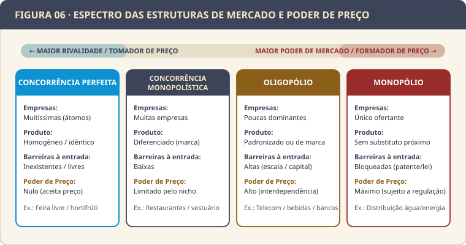

# 05 · Estruturas e Falhas de Mercado na Estratégia Empresarial

[BENTO_INICIO]
- **Trilha Etária:** Técnico Modular · Jovens Adultos (19 a 21 anos)
- **Competência (Bloom):** Avaliar graus de poder de mercado via índice de concentração HHI, reconhecer práticas anticoncorrenciais e calcular externalidades na decisão de negócios.
- **Carga Horária:** 5 horas-aula · 2 encontros de 150 min (Aulas 09 e 10)
- **Entregável de Portfólio:** Matriz Competitiva Setorial e Parecer de Conformidade Concorrencial/Socioambiental
[BENTO_FIM]

## 1. O Desafio de Pedro (Assistente Júnior — 20 anos)

Pedro integra a equipe de planejamento de uma **distribuidora regional de bebidas e insumos alimentares** que avalia dois movimentos estratégicos para o próximo exercício:
1. Ingressar no mercado de distribuição de refrigerantes de uma microrregião onde **apenas 5 distribuidoras atuam**, com participações de mercado (*market share*) de **40%, 30%, 20%, 5% e 5%**; além disso, o diretor comercial sugeriu propor ao principal concorrente local uma "tabela amigável de preços mínimos por rota" para evitar guerra de descontos.
2. Reduzir custos de embalagem de um lote retornável deixando parte do descarte sem logística reversa, o que economizaria **R$ 4,00 por lote** no custo contábil privado, embora gere impacto ambiental local estimado em **R$ 6,50 por lote** se houver autuação e degradação da área industrial.

Como Pedro enquadra tecnicamente essa estrutura de mercado, alerta a diretoria sobre o risco legal antitruste de cartel e demonstra a diferença entre **custo privado** e **custo social** nas falhas de mercado?

---

## 2. Construindo o Conhecimento

### 2.1 Concorrência Perfeita versus Estruturas Imperfeitas (Aula 09)

Nem todo setor funciona como um mercado atomizado onde nenhuma empresa dita preços. Na Microeconomia aplicada à Administração, classificamos os mercados conforme quatro critérios estruturais: **número de ofertantes**, **diferenciação do produto**, **barreiras à entrada de concorrentes** e **poder de formação de preço** (PINDYCK; RUBINFELD, 2013; VASCONCELLOS; GARCIA, 2016).

Analise as quatro estruturas clássicas do lado da oferta e suas variantes do lado comprador ilustradas na **Figura 06**:

1. **Concorrência Perfeita:**
   - **Características:** muitíssimas empresas pequenas, produtos idênticos (homogêneos), informação transparente e livre entrada/saída.
   - **Efeito gerencial:** nenhuma firma controla o preço sozinha — ela é **tomadora de preço (*price taker*)**. Para ampliar lucro, só resta aumentar produtividade e reduzir custos internos. Exemplo próximo: hortifrúti de feira livre ou *commodities* agrícolas padronizadas.

2. **Concorrência Monopolística:**
   - **Características:** muitas empresas competindo no mesmo mercado, barreiras baixas à entrada, porém **produtos diferenciados** (marca, design, atendimento, localização, embalagem).
   - **Efeito gerencial:** a diferenciação confere pequeno poder de preço no nicho, mas lucros excessivos atraem novos entrantes rapidamente. Exemplo típico: restaurantes, barbearias, padarias artesanais, vestuário e prestadores de serviços locais.

3. **Oligopólio:**
   - **Características:** **poucas empresas grandes dominam a maior parcela do mercado**, altas barreiras à entrada (capital, economia de escala, logística, patentes) e forte **interdependência estratégica** — se um concorrente baixa preço ou lança campanha, os outros reagem. Exemplo: operadoras de telefonia, grandes bancos, cimenteiras, cervejarias, redes distribuidoras de combustíveis.
   - **Riscos de concentração e condutas ilícitas:** em oligopólios, empresas às vezes formam **cartéis** (acordo explícito ou tácito entre rivais independentes para fixar preços, dividir territórios ou restringir oferta — **prática ilegal no Brasil pela Lei nº 12.529/2011**, severamente punida pelo **CADE**), **trustes** (fusão ou incorporação societária para dominar um setor e eliminar concorrência) ou usam **holdings** (sociedade controladora de participações acionárias em várias empresas para exercer controle unificado).

4. **Monopólio:**
   - **Características:** **único produtor ou prestador** de bem sem substitutos próximos, protegido por barreiras intransponíveis (patentes legais, controle exclusivo de recurso estratégico ou **monopólio natural** quando um único investimento em rede sai mais barato que duplicar postes, tubulações de água ou trilhos).
   - **Efeito gerencial:** é **formador de preço (*price maker*)**, limitado apenas pela disposição a pagar da demanda e pela regulação tarifária de agências estatais (como ANEEL ou agências de saneamento).

Lado comprador (**poder de compra concentrado**): quando existem poucos compradores frente a muitos pequenos fornecedores, surge o **Oligopsônio** (ex.: poucas indústrias lácteas comprando leite de centenas de pequenos produtores rurais); quando existe um único comprador exclusivo, configura-se o **Monopsônio** (ex.: única usina ou mineradora comprando mão de obra ou insumos especializados de toda uma cidade).

> 📖 **GLOSSÁRIO**
> **Índice Herfindahl-Hirschman (HHI):** medida padrão de concentração econômica usada por autoridades antitruste, calculada somando o quadrado das participações percentuais (**si**) de cada empresa no mercado: `HHI = Σ si²` (escala de ~0 a 10.000 pontos).
> **Cartel:** conluio ilegal entre empresas concorrentes para combinar preços, dividir clientes ou limitar produção em prejuízo dos consumidores.

### 2.2 Medindo Concentração na Prática: o Índice HHI

Para que você não decida "no achismo" se um setor é pulverizado ou concentrado, analistas e órgãos de defesa da concorrência (como o **CADE — Conselho Administrativo de Defesa Econômica**) aplicam o **HHI**:

`HHI = s₁² + s₂² + ... + sn²`

Acompanhe o cálculo passo a passo com o setor avaliado por Pedro (**40%, 30%, 20%, 5% e 5%**):

`HHI = 40² + 30² + 20² + 5² + 5² = 1.600 + 900 + 400 + 25 + 25 =` **`2.950 pontos`**

Na leitura antitruste internacional e brasileira de referência:
- **HHI abaixo de 1.500 pontos:** mercado pouco concentrado / competitivo.
- **HHI entre 1.500 e 2.500 pontos:** concentração moderada.
- **HHI acima de 2.500 pontos:** **mercado altamente concentrado** — fusões entre grandes participantes nesse patamar sofrem escrutínio rigoroso ou reprovação regulatória, e o entrante menor precisa competir por nicho, agilidade logística ou serviço diferenciado, nunca por guerra direta de escala pura.

> 🛠️ **PARA PRATICAR**
> Imagine um mercado regional de internet banda larga onde atuam 4 provedores com participações iguais de **25% cada**. Calcule o **HHI** atual. Depois, recalcule o novo **HHI** caso o Provedor 1 compre o Provedor 2 (ficando com 50%, contra 25% e 25% dos demais) e classifique o grau de concentração antes e depois da fusão.

### 2.3 Falhas de Mercado: Externalidades, Bens Públicos e Assimetria (Aula 10)

Embora mercados competitivos tendam a alocar recursos com eficiência na maior parte do tempo, há situações específicas em que decisões privadas racionais produzem resultados socialmente ineficientes — fenômeno denominado **Falha de Mercado** (ROTH, 2016):

1. **Poder de Mercado (Monopólios e Cartéis):** empresas dominantes restringem oferta artificialmente para elevar preços acima do custo marginal, transferindo renda do consumidor e gerando **peso morto** (trocas benéficas que deixam de acontecer).
2. **Externalidades:** ocorrem quando a produção ou o consumo de um agente impõe **custos ou benefícios sobre terceiros** sem pagamento nem indenização no preço de mercado:
   - *Externalidade Negativa:* poluição hídrica de uma fábrica, congestionamento urbano, ruído noturno de centro logístico. O **Custo Social Marginal (CSMg)** supera o **Custo Privado Marginal (CPMg)** porque parte do dano é empurrada para a comunidade vizinha (`CSMg = CPMg + Custo Externo`).
   - *Externalidade Positiva:* vacinação em massa, pesquisa tecnológica aberta ou qualificação técnica profissional que eleva a produtividade de toda a cadeia regional.
3. **Bens Públicos:** bens que apresentam simultaneamente **não rivalidade** (o uso por uma pessoa não reduz a disponibilidade para outra) e **não excludabilidade** (é inviável impedir quem não pagou de usufruir) — caso da iluminação pública, segurança nacional e sinalização marítima. Por gerar o **problema do carona (*free rider*)**, empresas privadas raramente conseguem cobrar diretamente por esses bens, demandando provisão ou financiamento público.
4. **Assimetria de Informação:** ocorre quando uma parte da transação sabe muito mais sobre a qualidade ou risco do negócio do que a outra (*seleção adversa* antes do contrato, como venda de veículos usados com defeito oculto; e *risco moral* após o contrato, como descuido maior quando há seguro integral). Certificações, garantias, auditorias e contratos transparentes mitigam essa falha.

> ⚠️ **ATENÇÃO**
> A presença de uma falha de mercado não garante automaticamente que qualquer intervenção estatal melhore o resultado: também existem **Falhas de Governo** — quando regulações mal desenhadas, excesso burocrático, tabelas rígidas de preço ou captura regulatória distorcem incentivos e tornam a alocação ainda menos eficiente do que a original.

### 2.4 Defesa da Concorrência no Brasil e Compliance Empresarial

Para empresas modernas e gestores formados em Administração, conhecer a atuação do **CADE** faz parte do *compliance* corporativo básico. Atos de concentração acima dos critérios legais de faturamento exigem notificação prévia, e combinações de preço com concorrentes podem resultar em multas milionárias sobre o faturamento bruto, responsabilização pessoal de administradores e bloqueio de contratação com o setor público.

> 💡 **SAIBA MAIS**
> Em atuações recentes no setor de combustíveis líquidos, o **CADE** aplicou sanções somando **mais de R$ 150 milhões em multas** contra redes de postos e distribuidoras envolvidas em formação de cartel no Distrito Federal e entorno, além de priorizar o monitoramento concorrencial desse mercado por meio da **Portaria CADE nº 379/2025** e estudos societários do Departamento de Estudos Econômicos (CADE, 2025a, 2025b).

> ❓ **REFLITA**
> Por que selos independentes de auditoria, garantia de 12 meses e avaliações verificadas de compradores aumentam o valor de mercado de um e-commerce? Qual falha de mercado específica esses mecanismos combatem?

> 🎬 **MÍDIAS INTEGRADAS**
> Acesse **`html/aula-09.html`** (Simulador de Estruturas de Mercado & Calculadora HHI de Fusões) e **`html/aula-10.html`** (Laboratório de Externalidades: compare Custo Privado × Custo Social e simule efeitos de taxas/logística reversa).

---

## 3. Síntese — Pedro em Ação

> 🚀 **SÍNTESE — PEDRO EM AÇÃO**
> Pedro entregou à diretoria um parecer técnico sólido dividindo os dois alertas:
> 1. **Diagnóstico de Mercado e Risco de Cartel:** somando `40² + 30² + 20² + 5² + 5²`, apurou um **HHI de 2.950 pontos**, provando tratar-se de **oligopólio altamente concentrado**. Pedro recomendou **rejeitar imediatamente** qualquer proposta de "tabela amigável de preços mínimos" com concorrente — pois configura **cartel ilícito (Lei nº 12.529/2011)** — e propôs estratégia competitiva lícita baseada em diferenciação de prazo de entrega e mix de atendimento para pequenos varejistas.
> 2. **Internalização de Externalidade:** demonstrou que a suposta "economia" de **R$ 4,00/lote** escondia um **custo externo de R$ 6,50/lote** no passivo socioambiental (elevando o custo econômico social além da economia aparente) e estruturou parceria com cooperativa de reciclagem local para neutralizar riscos legais e preservar a reputação da marca.

---

## 4. Desafio de Portfólio Profissional

Desenvolva uma **Auditoria Concorrencial e de Externalidades** para o seu portfólio:
1. **Escolha** um segmento econômico da sua região com 4 a 6 competidores conhecidos (academias, supermercados, postos de combustíveis, farmácias ou provedores de internet).
2. **Estime** as participações aproximadas de mercado (%) e calcule o **HHI**, classificando o nível de concentração do setor.
3. **Liste** 1 externalidade negativa ou assimetria de informação presente nesse setor e proponha 1 medida de gestão privada (logística reversa, certificação, contrato claro) para reduzi-la.
4. **Conclua** o caso real [`estudo-de-caso/EC03-concentracao-mercados-e-concorrencia.md`](../estudo-de-caso/EC03-concentracao-mercados-e-concorrencia.md) e a lista [`exercícios/L05-estruturas-e-falhas-de-mercado.md`](../exercícios/L05-estruturas-e-falhas-de-mercado.md).

[PROFESSOR_INICIO]
Orientação docente (Aulas 09 e 10 — 150 min cada):
- Na Aula 09, use `html/aula-09.html` para simular o impacto de uma fusão fictícia no HHI e discuta os julgados reais do CADE (`EC03`). Enfatize para os jovens adultos (19–21 anos) que mensagens de WhatsApp combinando reajuste de preços entre empresários locais já caracterizam evidência de conduta anticompetitiva.
- Gabarito do boxe "Para Praticar" (HHI Provedores): Antes: `4 × 25² = 4 × 625 = 2.500` (limite de alta concentração). Após fusão (50%, 25%, 25%): `50² + 25² + 25² = 2.500 + 625 + 625 = 3.750` pontos (aumento líquido de `ΔHHI = +1.250` pontos — salto crítico para análise antitruste!).
[PROFESSOR_FIM]

---

## 5. Referências

BRASIL. **Lei nº 12.529, de 30 de novembro de 2011**. Estrutura o Sistema Brasileiro de Defesa da Concorrência. Brasília, DF: Presidência da República, 2011.

CONSELHO ADMINISTRATIVO DE DEFESA ECONÔMICA (CADE). **Cade aplica mais de R$ 150 milhões em multas por cartel de combustíveis no DF**. Brasília: CADE, 2025a. Disponível em: https://www.gov.br/cade/pt-br/assuntos/noticias/cade-aplica-mais-de-r-150-milhoes-em-multas-por-cartel-de-combustiveis-no-df. Acesso em: 15 nov. 2026.

CONSELHO ADMINISTRATIVO DE DEFESA ECONÔMICA (CADE). **Cade lança estudo sobre distribuição e revenda de combustíveis líquidos**. Brasília: CADE, 2025b. Disponível em: https://www.gov.br/cade/pt-br/assuntos/noticias/cade-lanca-estudo-sobre-distribuicao-e-revenda-de-combustiveis-liquidos. Acesso em: 15 nov. 2026.

PINDYCK, Robert S.; RUBINFELD, Daniel L. **Microeconomia**. 8. ed. São Paulo: Pearson, 2013.

ROTH, Alvin E. **Como funcionam os mercados**: a nova economia das combinações e do desenho de mercado. São Paulo: Portfolio-Penguin, 2016.

VASCONCELLOS, Marco Antônio Sandoval de; GARCIA, Manuel Enriquez. **Fundamentos de economia**. 6. ed. São Paulo: Saraiva, 2016.

---
[← 04 · Equilíbrio de Mercado, Elasticidade e Preços](04-equilibrio-elasticidade-e-precos.md) · [Próximo: 06 · Macroeconomia: PIB, Renda e Consumo →](06-macroeconomia-pib-renda-e-consumo.md)
