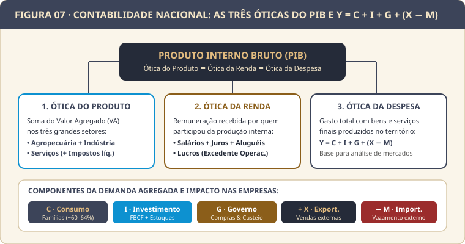

# 06 · Macroeconomia e Contabilidade Nacional: PIB, Renda e Consumo

[BENTO_INICIO]
- **Trilha Etária:** Técnico Modular · Jovens Adultos (19 a 21 anos)
- **Competência (Bloom):** Calcular o PIB sem dupla contagem, deflacionar faturamento e PIB nominal em valores reais e estimar efeitos dos componentes de demanda agregada nas empresas.
- **Carga Horária:** 5 horas-aula · 2 encontros de 150 min (Aulas 11 e 12)
- **Entregável de Portfólio:** Relatório de Desempenho Real de Vendas Deflacionado vs. Ciclo do PIB Setorial
[BENTO_FIM]

## 1. O Desafio de Pedro (Assistente Júnior — 20 anos)

Pedro acompanha o fechamento anual de uma **rede regional de materiais de construção e eletrodomésticos**. Na reunião de resultados, a diretoria comemorou que o faturamento bruto da empresa cresceu **10,0%** no ano — saltando de **R$ 1.000.000,00** para **R$ 1.100.000,00** — e planejava contratar mais duas equipes comerciais apostando em "expansão física acelerada de 10% no mercado".

Entretanto, Pedro checou os demonstrativos e constatou dois sinais amarelos: (1) o índice médio de preços dos itens vendidos subiu **8,0%** no mesmo período; e (2) boletins oficiais do IBGE indicavam forte desaceleração no **Consumo das Famílias** por efeito de juros elevados.

Como Pedro utiliza a **Contabilidade Nacional** e a **Macroeconomia** para separar ilusão nominal de crescimento físico real — e mostrar como cada componente da demanda agregada (`C, I, G, X, M`) altera as metas da empresa?

---

## 2. Construindo o Conhecimento

### 2.1 Contabilidade Nacional: PIB, PNB e as Três Óticas de Mensuração (Aula 11)

Enquanto a Microeconomia analisa empresas e mercados isolados, a **Macroeconomia** estuda o comportamento agregado da economia inteira — produção nacional, renda total, nível de emprego, inflação, taxas de juros e comércio exterior (SANDRONI, 2000; FEIJÓ; RAMOS, 2013). Para medir o tamanho e o ritmo dessa atividade econômica, os países adotam o sistema de **Contabilidade Nacional**.

O indicador central dessa medição é o **Produto Interno Bruto (PIB)**: a **soma de todos os bens e serviços finais produzidos dentro das fronteiras geográficas de um país em determinado período** (trimestre ou ano), expressa em valores monetários de mercado. Atente para três palavras-chave dessa definição:
- **Finais:** contam-se apenas produtos entregues ao uso final, evitando **dupla contagem** de matérias-primas já embutidas no preço do produto acabado.
- **Interno (territorial):** contabiliza tudo o que foi produzido **dentro do Brasil**, tanto por empresas brasileiras quanto por multinacionais aqui instaladas.
- **Produzidos no período:** compra de imóvel antigo ou veículo usado não entra como novo PIB (apenas a comissão de intermediação gerada neste ano).

> 📖 **GLOSSÁRIO**
> **PIB (Produto Interno Bruto):** valor monetário de todos os bens e serviços finais gerados dentro do território nacional em dado período.
> **PNB / RNB (Produto/Renda Nacional Bruta):** valor da produção gerada por fatores pertencentes a **residentes nacionais**, obtido subtraindo a renda líquida enviada ao exterior (`PNB = PIB − RLEE`).

Acompanhe um exemplo exato para eliminar o erro clássico de dupla contagem utilizando a **Ótica do Valor Agregado**:
1. Um produtor rural colhe e vende trigo ao moinho por **R$ 100,00** (Valor Agregado = **R$ 100,00**).
2. O moinho transforma em farinha e vende à padaria por **R$ 180,00** (Valor Agregado pelo moinho = `180 − 100 =` **R$ 80,00**).
3. A padaria assa e vende pães ao consumidor final por **R$ 300,00** (Valor Agregado pela padaria = `300 − 180 =` **R$ 120,00**).

Somar os três faturamentos brutos (`100 + 180 + 300 = R$ 580,00`) cometeria **dupla contagem**! Somando exclusivamente os valores agregados em cada elo (`100 + 80 + 120 =` **R$ 300,00**), encontramos exatamente o valor final entregue ao consumidor!

Como ilustra a **Figura 07**, existem **três caminhos equivalentes** para apurar o mesmo PIB (no Brasil, calculado trimestralmente e anualmente pelo **IBGE**):
1. **Ótica do Produto (Valor Agregado):** soma o valor adicionado pela **Agropecuária**, pela **Indústria** e pelos **Serviços**, acrescido dos impostos líquidos de subsídios sobre produtos.
2. **Ótica da Renda:** soma todas as remunerações geradas no processo produtivo (**Salários** + **Aluguéis** + **Juros** + **Lucros/Excedente Operacional Bruto** + impostos sobre a produção). Tudo o que é produzido vira renda de alguém!
3. **Ótica da Despesa (Demanda Agregada):** soma todos os gastos efetuados pelos quatro grandes setores compradores com bens finais produzidos no país:

`PIB = Y = C + I + G + (X − M)`

### 2.2 PIB Nominal versus PIB Real e o Deflator Implícito

Se o PIB em reais subiu de um ano para outro, isso ocorreu porque as fábricas produziram mais unidades ou simplesmente porque os preços subiram com a inflação? Para responder sem ilusão monetária, distinguimos:
- **PIB Nominal (a preços correntes):** calcula quantidades do ano multiplicadas pelos preços do próprio ano.
- **PIB Real (a preços constantes):** isola apenas o crescimento físico das quantidades, removendo a variação de preços por meio de um índice de preços chamado **Deflator do PIB**:

`PIB Real = PIB Nominal ÷ Índice de Preços (Deflator ÷ 100)`

Aplique a fórmula em um exemplo rápido: se o faturamento ou PIB nominal cresce de **R$ 1.000,00 bi** (índice base = 100) para **R$ 1.100,00 bi** enquanto o deflator médio de preços sobe **8,0%** (índice = 108), o valor real ajustado é:

`PIB Real = 1.100 ÷ 1,08 =` **`R$ 1.018,52 bi`**  ⇒  **`Crescimento Real = +1,85%`**

Da mesma forma, o **PIB *per capita*** divide o PIB total pela população residente do país, indicando uma média macroeconômica de renda por habitante (embora não revele sozinho o grau de desigualdade na distribuição dessa renda).

> ⚠️ **ATENÇÃO**
> Nunca avalie metas de vendedores, comissões ou expansão de lojas apenas pelo crescimento **nominal** do faturamento em períodos inflacionários! Se o faturamento subiu 6% ao ano mas os preços médios do setor subiram 7%, a empresa na verdade encolheu em volume físico vendido.

> 🛠️ **PARA PRATICAR**
> Em uma cadeia produtiva de calçados, a indústria de couro fatura R$ 250 mil vendendo matéria-prima à fábrica de sapatos; a fábrica vende os calçados ao varejo por R$ 620 mil; o varejo vende aos consumidores finais por R$ 950 mil. Calcule o Valor Agregado em cada etapa e comprove o PIB gerado nessa cadeia sem dupla contagem.

### 2.3 Componentes da Demanda Agregada (`Y = C + I + G + X − M`) e Efeito Multiplicador (Aula 12)

Para o administrador planejar vendas, compras e financiamento, a **Ótica da Despesa** funciona como um painel de controle do mercado consumidor nacional:

1. **C — Consumo das Famílias:** maior componente do PIB brasileiro (~60% a 64% da despesa total). Depende da **massa salarial**, do **nível de emprego**, da **oferta e custo do crédito** às pessoas físicas, das **transferências de renda** e da **confiança do consumidor**. Quando o crédito encarece, caem primeiro bens duráveis financiados (eletrodomésticos, veículos, móveis).
2. **I — Investimento Privado (Formação Bruta de Capital Fixo — FBCF + Variação de Estoques):** compras de máquinas, galpões, tecnologia, frotas e obras realizadas pelas empresas para expandir capacidade produtiva — e variação de estoques não vendidos. **Atenção:** na linguagem econômica, comprar ações na bolsa ou aplicar em CDB é *aplicação financeira*, não *investimento macroeconômico (`I`)*, pois não cria fábrica nem máquina nova diretamente! O Investimento **I** é altamente sensível à **taxa de juros real** e às **expectativas de lucro futuro**.
3. **G — Gastos do Governo:** compras públicas de medicamentos, merenda, obras de saneamento/rodovias e folha de servidores ativos (excluem-se transferências previdenciárias puras como aposentadorias para não contar duas vezes quando o beneficiário gastar em **C**).
4. **(X − M) — Exportações Líquidas (Saldo da Balança Comercial de Bens e Serviços):** **Exportações (`X`)** somam renda gerada no Brasil comprada pelo exterior (soja, minério, carnes, aviões, serviços de TI); **Importações (`M`)** são subtraídas porque representam parte do gasto de **C**, **I** ou **G** que foi destinada a bens fabricados fora do país.

Na dinâmica de curto prazo descrita pela tradição keynesiana, alterações em qualquer componente autônomo disparam o **Efeito Multiplicador do Gasto**: como o gasto de um agente torna-se renda do fornecedor e dos trabalhadores, parte dessa nova renda — medida pela **Propensão Marginal a Consumir (`c = ΔC ÷ ΔYd`)** — gira novamente em novas compras! Em um modelo fechado simplificado sem tributos proporcionais nem vazamento externo:

`k = 1 ÷ (1 − c)`

Se **`c = 0,75`** (75% da renda adicional é gasta em consumo), então **`k = 1 ÷ (1 − 0,75) = 1 ÷ 0,25 = 4,0`**. Um novo investimento industrial de **R$ 10 milhões** gera uma cadeia de consumo capaz de ampliar a renda agregada potencial em até **R$ 40 milhões** (embora na economia real brasileira tributos e importações amorteçam esse multiplicador).

### 2.4 Retrato Recente do PIB Brasileiro para Decisões de Gestão

Observar séries reais publicadas pelo IBGE mostra como essas variáveis operam na prática das empresas brasileiras:

| Indicador Oficial (IBGE) | Resultado 2024 | Resultado 2025 | Leitura Gerencial para Administração |
| :--- | :---: | :---: | :--- |
| **PIB Real (Variação Anual)** | **+3,4%** | **+2,3%** | Economia manteve crescimento positivo, porém desacelerou ritmo |
| **PIB Nominal (Valores Correntes)** | **R$ 11,7 trilhões** | **R$ 12,7 trilhões** | Mercado consumidor amplo exige acompanhamento regional |
| **Consumo das Famílias (C)** | **+5,1%** | **+1,3%** | Desaceleração forte sob juros altos restringiu vendas a prazo |
| **Agropecuária / Indústria / Serviços (2025)** | — | **+11,7% / +1,4% / +1,8%** | Safra puxou agro; serviços seguraram emprego urbano |

*Fonte: Elaborado com base em dados oficiais do Sistema de Contas Nacionais Trimestrais (IBGE, 2025, 2026).*

> 💡 **SAIBA MAIS**
> Em **2025**, o **PIB *per capita*** brasileiro atingiu **R$ 59.687,49** (avanço real de **1,9%** ante 2024), mas a desaceleração do **Consumo das Famílias** de **5,1% (2024)** para **1,3% (2025)** — chegando à estabilidade (`0,0%`) na margem do 4º trimestre — evidenciou o impacto direto da política monetária restritiva sobre compras parceladas, exigindo das empresas maior controle de estoques e capital de giro (IBGE, 2026).

> ❓ **REFLITA**
> Se uma rede varejista abre três filiais em uma cidade cujo agronegócio local acaba de registrar alta de 11,7% na safra, em que ordem as empresas de insumos, oficinas mecânicas e comércio varejista sentem o efeito multiplicador dessa renda?

> 🎬 **MÍDIAS INTEGRADAS**
> Explore **`html/aula-11.html`** (Calculador das Três Óticas do PIB e Conversor Nominal → Real) e **`html/aula-12.html`** (Simulador Macroeconômico `Y = C + I + G + (X − M)` e Multiplicador do Gasto).

---

## 3. Síntese — Pedro em Ação

> 🚀 **SÍNTESE — PEDRO EM AÇÃO**
> Pedro aplicou a fórmula do **Deflator** ao faturamento da rede de materiais de construção (`R$ 1.000.000,00` → `R$ 1.100.000,00` sob inflação setorial média de `8,0%`):
> `Faturamento Real Ajustado = 1.100.000 ÷ 1,08 =` **`R$ 1.018.518,52`**  ⇒  **`Crescimento Físico Real = +1,85%`**
> Ao confrontar esse **+1,85% real** (muito distante dos 10% ilusórios!) com a desaceleração oficial do **Consumo das Famílias (+1,3% em 2025)** sob juros restritivos, Pedro recomendou à diretoria **suspender a abertura apressada de duas equipes fixas** — substituindo a expansão por metas focadas em giro de estoque e assistência comercial com menor custo fixo até a melhora do ciclo de crédito.

---

## 4. Desafio de Portfólio Profissional

Monte um **Painel de Leitura Macroeconômica Setorial**:
1. **Escolha** o setor em que você trabalha ou pretende atuar (comércio varejista, logística, indústria, tecnologia, saúde ou construção).
2. **Classifique** qual componente de `Y = C + I + G + (X − M)` mais comanda as vendas desse setor e justifique em 5 linhas por quê.
3. **Deflacione** um faturamento hipotético que cresceu de R$ 240 mil para R$ 264 mil em um ano em que os preços do setor subiram 6,0%, indicando o crescimento físico real em percentual.
4. **Execute** o estudo de caso real [`estudo-de-caso/EC04-pib-consumo-e-ciclo-economico-brasil.md`](../estudo-de-caso/EC04-pib-consumo-e-ciclo-economico-brasil.md) e resolva [`exercícios/L06-macroeconomia-pib-renda-e-consumo.md`](../exercícios/L06-macroeconomia-pib-renda-e-consumo.md).

[PROFESSOR_INICIO]
Orientação docente (Aulas 11 e 12 — 150 min cada):
- Reforce na Aula 11 com `html/aula-11.html` o cálculo de Valor Agregado e o erro clássico de confundir "subiu 10% o caixa" com "vendeu 10% mais peças" quando houve reajuste de tabela.
- Gabarito do boxe "Para Praticar" (Calçados): Couro = `R$ 250 mil` VA; Fábrica = `620 - 250 = R$ 370 mil` VA; Varejo = `950 - 620 = R$ 330 mil` VA. Soma dos VAs = `250 + 370 + 330 = R$ 950 mil` (igual ao valor do bem final!).
[PROFESSOR_FIM]

---

## 5. Referências

FEIJÓ, Carmem Aparecida; RAMOS, Roberto Luís Olinto (Orgs.). **Contabilidade social**: a nova referência das contas nacionais do Brasil. 4. ed. Rio de Janeiro: Elsevier, 2013.

INSTITUTO BRASILEIRO DE GEOGRAFIA E ESTATÍSTICA (IBGE). **PIB cresce 3,4% em 2024 e fecha o ano em R$ 11,7 trilhões**. Rio de Janeiro: Agência de Notícias IBGE, 2025. Disponível em: https://agenciadenoticias.ibge.gov.br/agencia-noticias.html. Acesso em: 15 nov. 2026.

INSTITUTO BRASILEIRO DE GEOGRAFIA E ESTATÍSTICA (IBGE). **PIB cresce 2,3% em 2025 e fecha o ano em R$ 12,7 trilhões**. Rio de Janeiro: Agência de Notícias IBGE, 2026. Disponível em: https://agenciadenoticias.ibge.gov.br/agencia-noticias/2012-agencia-de-noticias/noticias/43831-pib-cresce-2-3-em-2025.html. Acesso em: 15 nov. 2026.

SANDRONI, Paulo. **Traduzindo o economês**: para entender a economia brasileira na época da globalização. São Paulo: Best Seller, 2000.

---
[← 05 · Estruturas e Falhas de Mercado](05-estruturas-e-falhas-de-mercado.md) · [Próximo: 07 · Moeda, Crédito e Sistema Financeiro →](07-moeda-credito-e-sistema-financeiro.md)
