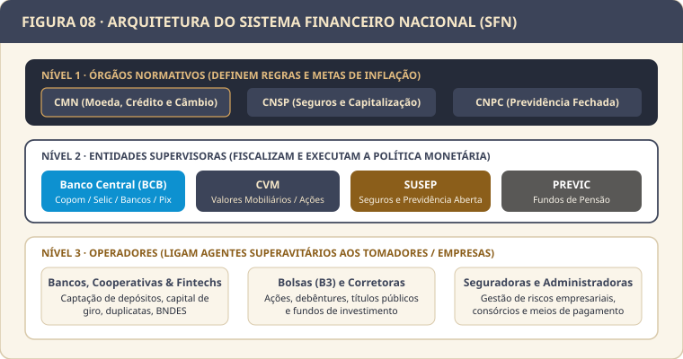

# 07 · Teoria Monetária, Crédito e Sistema Financeiro Nacional (SFN)

[BENTO_INICIO]
- **Trilha Etária:** Técnico Modular · Jovens Adultos (19 a 21 anos)
- **Competência (Bloom):** Analisar funções e agregados monetários, calcular o multiplicador bancário e comparar estruturas de crédito e spread no SFN.
- **Carga Horária:** 5 horas-aula · 2 encontros de 150 min (Aulas 13 e 14)
- **Entregável de Portfólio:** Mapa de Captação Financeira e Diagnóstico de Spread de Crédito Empresarial
[BENTO_FIM]

## 1. O Desafio de Pedro (Assistente Júnior — 20 anos)

Pedro apoia a tesouraria de uma **transportadora de cargas e operador logístico regional** que precisa financiar **R$ 200.000,00** em capital de giro e renovação leve de equipamentos por 12 meses. Ao cotar crédito, a empresa recebeu duas propostas: um **banco comercial privado** ofertou taxa efetiva anual de **28,0% a.a.** alegando que *"o juro básico do país é de 15,0%, então o custo do banco seria inevitável"*; enquanto uma **cooperativa de crédito vinculada a linha de repasse regulada pelo CMN/BCB** propôs **21,5% a.a.** sob análise de garantias reais.

Por que existe uma diferença de **13,0 pontos percentuais** entre a taxa básica do Banco Central (15,0%) e a taxa cobrada no balcão do banco (28,0%), como os bancos multiplicam recursos via crédito e qual papel cada órgão do **Sistema Financeiro Nacional (SFN)** exerce nessa operação?

---

## 2. Construindo o Conhecimento

### 2.1 Evolução da Moeda, Funções e Meios de Pagamento (Aula 13)

Antes da moeda, as sociedades trocavam mercadorias diretamente por meio do **escambo** — sistema limitado pela exigência de *"dupla coincidência de desejos"* (o fabricante de sapatos precisava achar alguém que quisesse sapatos e também produzisse exatamente o alimento que ele desejava). Para superar essa fricção comercial e permitir a especialização produtiva das empresas, surgiu a **moeda**, evoluindo historicamente de moedas-mercadoria (sal, gado, grãos) e metais cunhados (ouro, prata) até a **moeda fiduciária contemporânea** (lastreada na confiança institucional do Estado emissor e aceitação legal de curso forçado) e nos **meios eletrônicos e instantâneos** (TED, cartões, Pix).

Para que um ativo funcione economicamente como moeda, precisa cumprir três funções simultâneas:
1. **Meio de Troca (Intermediário de Trocas):** aceito amplamente na liquidação imediata de bens, serviços e salários, eliminando o escambo.
2. **Unidade de Conta (Padrão de Valor):** permite medir e comparar preços, custos e balanços contábeis em uma única escala numérica (reais, dólares, euros).
3. **Reserva de Valor:** possibilita guardar poder aquisitivo no tempo para gastar no futuro — função que se **deteriora rapidamente quando há inflação alta**, fazendo empresas e famílias fugirem da moeda parada em caixa.

Na estatística monetária do Banco Central do Brasil, mede-se a liquidez da economia por **agregados monetários** em ordem crescente de abrangência e decrescente de liquidez imediata:

| Agregado | Composição Principal no Brasil | Liquidez para a Empresa |
| :---: | :--- | :--- |
| **`M1`** | Papel-moeda em poder do público (`PMPP`) + Depósitos à vista nos bancos | **Imediata** (caixa + conta corrente movimento) |
| **`M2`** | `M1` + Depósitos em poupança + Títulos privados emitidos por instituições depositárias (CDB, RDB, LCI, LCA, letras financeiras) | Alta (resgate rápido no caixa corporativo) |
| **`M3`** | `M2` + Quotas de fundos de renda fixa + Operações compromissadas registradas no Selic | Média-alta (liquidez de tesouraria) |
| **`M4`** | `M3` + Títulos públicos federais de alta liquidez em poder do público não financeiro (Tesouro Direto / LFT / LTN) | Poupança financeira ampla |

> 📖 **GLOSSÁRIO**
> **Moeda Fiduciária:** moeda sem valor intrínseco material equivalente ao seu valor de face (o papel-moeda não vale ouro equivalente), sustentada pela confiança na estabilidade econômica e no poder liberatório legal conferido pelo Estado.
> **Liquidez:** facilidade e rapidez com que um ativo é convertido em dinheiro vivo ou saldo bancário disponível sem perda significativa de valor.

### 2.2 Multiplicador Bancário e Criação de Moeda Escritural

Uma das descobertas mais importantes da Teoria Monetária para futuros administradores é entender que **o Banco Central não imprime sozinho todo o dinheiro que circula na economia**: os bancos comerciais criam **moeda escritural (bancária)** ao receber depósitos à vista e conceder empréstimos a terceiros mantendo apenas uma fração como **reserva**!

Acompanhe numericamente passo a passo supondo que você deposite **R$ 1.000,00** em dinheiro no Banco A, sob uma exigência oficial de **recolhimento compulsório (`r`) de 20% (`0,20`)** e assumindo que todo valor emprestado retorna em depósito no sistema bancário:
- **Rodada 1 (Banco A):** recebe `R$ 1.000,00` → retém `20%` (`R$ 200,00` de reserva) → empresta **`R$ 800,00`** a uma empresa cliente.
- **Rodada 2 (Banco B):** a empresa paga fornecedor que deposita `R$ 800,00` → Banco B retém `20%` (`R$ 160,00`) → empresta **`R$ 640,00`**.
- **Rodada 3 (Banco C):** recebe `R$ 640,00` → retém `20%` (`R$ 128,00`) → empresta **`R$ 512,00`** — e assim sucessivamente em progressão geométrica decrescente!

A soma limite de toda a moeda escritural gerada pelo sistema obtém-se pela fórmula do **Multiplicador Bancário Teórico (`m`)**:

`m = 1 ÷ r = 1 ÷ 0,20 = 5`

Logo, os **R$ 1.000,00** originais transformam-se em até **`5 × R$ 1.000,00 = R$ 5.000,00`** de meios de pagamento disponíveis para consumo e financiamento empresarial (sendo **R$ 1.000,00** da base monetária inicial + **R$ 4.000,00** criados pelo crédito bancário). Se o Banco Central eleva o compulsório para **25%**, o multiplicador cai para `4`, contraindo imediatamente o crédito disponível no mercado! *(Na prática real, parte do dinheiro fica em espécie com o público e os bancos retêm reservas voluntárias extras, tornando o multiplicador efetivo menor que o teórico.)*

> 🛠️ **PARA PRATICAR**
> Suponha um depósito inicial de **R$ 2.000,00** em um sistema bancário sem retenção em papel-moeda pelo público, no qual a taxa de recolhimento compulsório (`r`) é **25%**. Calcule o multiplicador bancário máximo e o saldo final total de moeda (depósitos acumulados) criado após todas as rodadas de empréstimo.

### 2.3 Arquitetura do Sistema Financeiro Nacional — SFN (Aula 14)

O **Sistema Financeiro Nacional (SFN)** é o conjunto de instituições, normas e mercados responsáveis por intermediar recursos entre **agentes superavitários** (famílias e empresas que poupam acima do que gastam hoje) e **agentes deficitários** (empresas que precisam financiar máquinas/capital de giro e famílias financiando imóveis/consumo).

Como detalha a **Figura 08**, o SFN brasileiro organiza-se em **três níveis hierárquicos bem definidos**:
1. **Nível 1 — Órgãos Normativos (não operam com clientes; definem regras e diretrizes):**
   - **CMN (Conselho Monetário Nacional):** órgão máximo do sistema; formula diretrizes de moeda, crédito e câmbio e **fixa a meta anual da inflação** perseguida pelo Banco Central.
   - **CNSP e CNPC:** normatizam seguros privados/capitalização e previdência complementar fechada.
2. **Nível 2 — Entidades Supervisoras (fiscalizam, autorizam e executam normas):**
   - **Banco Central do Brasil (BCB):** executa a política monetária e cambial, controla o meio circulante e o **Pix**, supervisiona bancos/cooperativas/fintechs de pagamento e, por meio do **Copom (Comitê de Política Monetária)**, define a **Taxa Selic Meta**.
   - **CVM (Comissão de Valores Mobiliários):** regula e fiscaliza o mercado de capitais (ações na B3, debêntures, fundos de investimento e companhias abertas).
   - **SUSEP e PREVIC:** fiscalizam seguradoras/previdência aberta e fundos de pensão.
3. **Nível 3 — Operadores (atendem diretamente cidadãos e empresas):** bancos múltiplos e comerciais, bancos públicos de desenvolvimento (**BNDES**), cooperativas de crédito, corretoras, **B3 (bolsa oficial)**, administradoras de cartões, seguradoras e fintechs de crédito.

### 2.4 Crédito Empresarial, *Spread* Bancário e Acesso de PMEs

Ao contratar um empréstimo de capital de giro, o administrador encontra o conceito de ***Spread* Bancário**: a diferença entre a taxa final cobrada do tomador do empréstimo e o custo base de captação pago pelo banco ao poupador ou balizado pela Selic/CDI.

Decomponha um *spread* típico ilustrativo para entender por que a taxa ao tomador supera em muito a Selic básica:

`Taxa Final (28,0%) = 15,0% [Captação Selic/CDI] + 4,5 p.p. [Custo Adm. + FGC] + 5,0 p.p. [Inadimplência + Perdas] + 3,5 p.p. [Tributos/Compulsório + Margem]`

Aqui o **spread bruto é de `28,0% − 15,0% = 13,0 p.p.`**. Garantias sólidas, histórico fiscal em dia, relacionamento cooperativo e linhas com fundos garantidores públicos (como FGO/FGI/BNDES) reduzem a parcela de **risco de inadimplência**, baixando a taxa final contratada pela empresa!

> ⚠️ **ATENÇÃO**
> Antes de aceitar crédito caro de curto prazo (cheque especial corporativo ou cartão rotativo empresarial), compare sempre o **Custo Efetivo Total (CET)** anual — que inclui tarifas de abertura de crédito, IOF e seguros embutidos — e avalie se o retorno operacional do estoque ou contrato financiado supera essa taxa!

> 💡 **SAIBA MAIS**
> Pesquisas do Sebrae sobre o financiamento das micro e pequenas empresas no Brasil em **2025** revelaram um comportamento cauteloso diante do custo elevado do dinheiro: apenas cerca de **15% dos pequenos empresários buscaram novos empréstimos**, sendo **capital de giro** o motivo número um (**41%** dos pedidos), enquanto a taxa de aprovação subiu para **48%** quando havia boa organização cadastral e garantias estruturadas (SEBRAE PARANÁ, 2025).

> ❓ **REFLITA**
> Por que o fortalecimento de cooperativas de crédito e fintechs reguladas pelo Banco Central tende a reduzir o *spread* bancário para pequenas e médias empresas regionais? Relacione sua resposta ao Capítulo 05 (estruturas de mercado).

> 🎬 **MÍDIAS INTEGRADAS**
> Abra **`html/aula-13.html`** (Simulador de Multiplicador Bancário e Reserva Compulsória) e **`html/aula-14.html`** (Mapa Interativo do SFN + Calculadora de Spread Bancário e Capital de Giro).

---

## 3. Síntese — Pedro em Ação

> 🚀 **SÍNTESE — PEDRO EM AÇÃO**
> Pedro montou um parecer financeiro completo explicando à diretoria da transportadora os dois pontos solicitados:
> 1. **Origem da diferença de 13,0 p.p. no banco privado:** demonstrou que a taxa de **15,0% a.a.** refere-se apenas ao patamar básico monetário (Selic/captação). Os **13,0 pontos percentuais adicionais** compõem o ***spread* bancário** do banco comercial — refletindo custo administrativo, cunha fiscal (IOF/tributos), recolhimento compulsório e provisão elevada para risco de inadimplência sem garantia real.
> 2. **Economia concreta com a cooperativa/linha assistida (`21,5% a.a.` vs. `28,0% a.a.`):** sobre o financiamento de **R$ 200.000,00** em 12 meses, a redução de **6,5 p.p.** na taxa anual evita um gasto financeiro aproximado de **R$ 13.000,00/ano** (cerca de **R$ 7.200+ em parcelas mensais equivalentes** na amortização Price). Pedro recomendou formalizar as garantias cadastrais e contratar a linha de **21,5% a.a.**, preservando liquidez no fluxo de caixa.

---

## 4. Desafio de Portfólio Profissional

Desenvolva um **Diagnóstico de Sistema Financeiro e Crédito Corporativo** para o seu portfólio:
1. **Diferencie**, em um quadro próprio de até 6 linhas, os papéis do **CMN**, do **Banco Central (Copom)** e da **CVM** caso uma empresa brasileira queira emitir debêntures ou tomar financiamento bancário.
2. **Simule** o efeito de uma redução do recolhimento compulsório de **25% para 20%** sobre a capacidade teórica máxima de criação de moeda escritural a partir de um depósito de **R$ 10.000,00**.
3. **Analise** o CET e os quatro componentes do *spread* que você verificaria antes de aprovar uma linha de capital de giro de R$ 50.000,00 para uma microempresa.
4. **Resolva** a lista [`exercícios/L07-moeda-credito-e-sistema-financeiro.md`](../exercícios/L07-moeda-credito-e-sistema-financeiro.md).

[PROFESSOR_INICIO]
Orientação docente (Aulas 13 e 14 — 150 min cada):
- Na Aula 13, utilize `html/aula-13.html` para mostrar a tabela progressiva das primeiras rodadas do multiplicador bancário (`1.000 -> 800 -> 640 -> ...`) e discuta por que o Pix acelerou a velocidade de circulação sem extinguir a moeda escritural.
- Na Aula 14, desmistifique no quadro os papéis de CMN vs. BCB vs. CVM (questão recorrente em concursos e certificações financeiras como CPA-10/CPA-20).
- Gabarito "Para Praticar" (Depósito R$ 2.000,00, `r = 25%`): `m = 1 / 0,25 = 4`; saldo total criado = `4 × R$ 2.000,00 = R$ 8.000,00` (sendo `R$ 2.000,00` iniciais + `R$ 6.000,00` criados pelo crédito bancário).
[PROFESSOR_FIM]

---

## 5. Referências

ASSAF NETO, Alexandre. **Mercado financeiro**. 15. ed. São Paulo: Atlas, 2021.

BANCO CENTRAL DO BRASIL (BCB). **Sistema Financeiro Nacional (SFN): composição e segmentos**. Brasília: BCB, 2026. Disponível em: https://www.bcb.gov.br/estabilidadefinanceira/sfn. Acesso em: 15 nov. 2026.

SANDRONI, Paulo. **Traduzindo o economês**: para entender a economia brasileira na época da globalização. São Paulo: Best Seller, 2000.

SEBRAE PARANÁ. **Financiamento dos pequenos negócios no Brasil**: comportamento e acesso ao crédito em 2025. Curitiba: Sebrae/PR, 2025.

---
[← 06 · Macroeconomia: PIB, Renda e Consumo](06-macroeconomia-pib-renda-e-consumo.md) · [Próximo: 08 · Inflação, Índices de Preços e Juros →](08-inflacao-indices-e-taxas-de-juros.md)
