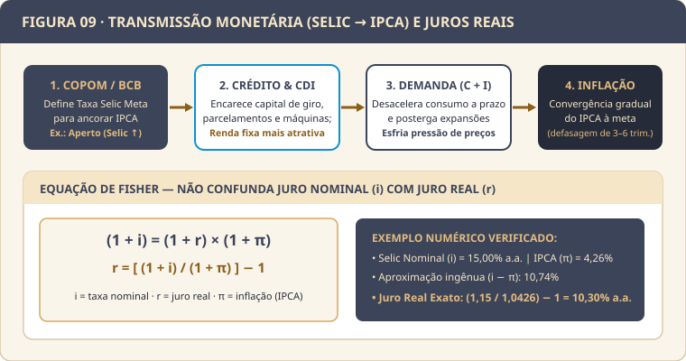

# 08 · Inflação, Índices de Preços e Taxas de Juros (Selic e Juros Reais)

[BENTO_INICIO]
- **Trilha Etária:** Técnico Modular · Jovens Adultos (19 a 21 anos)
- **Competência (Bloom):** Comparar metodologias de índices de preços brasileiros (IPCA, INPC, IGP-M), calcular variação inflacionária composta e apurar juros reais pela Equação de Fisher.
- **Carga Horária:** 5 horas-aula · 2 encontros de 150 min (Aulas 15 e 16)
- **Entregável de Portfólio:** Análise de Reajuste Contratual por Indexador e Simulação de Juro Real sobre Estoques
[BENTO_FIM]

## 1. O Desafio de Pedro (Assistente Júnior — 20 anos)

Pedro revisa o orçamento anual de uma **distribuidora regional de materiais elétricos e iluminação** em um período em que a **Taxa Selic Meta está em 15,00% ao ano** e o **IPCA acumulado oficial de 12 meses marca 4,26%**. Dois problemas surgiram na mesma semana:
1. O proprietário do centro de distribuição pediu reajuste do aluguel comercial de **R$ 10.000,00/mês** usando um índice que acumulou **9,8%**, enquanto o contador sugeriu tentar negociar substituição pelo **IPCA (`4,26%`)**. Além disso, um colega afirmou que *"a inflação de um trimestre com 1,0% ao mês soma exatamente 3,00%"*.
2. Na tesouraria, um diretor propôs tomar empréstimo rotativo a **18,0% ao ano** para estocar cabos de cobre por um ano esperando que a inflação de 4,26% "engolisse" quase todo o juro — argumentando informalmente que o juro real seria próximo de apenas "alguns pontinhos" sem considerar o impacto composto da taxa real de desconto sobre o capital empatado.

Como Pedro corrige o cálculo composto da inflação, compara tecnicamente os indexadores de contrato e aplica a **Equação de Fisher** para apurar a verdadeira taxa de **juro real** do país e da operação?

---

## 2. Construindo o Conhecimento

### 2.1 Conceito, Causas e Distorções da Inflação (Aula 15)

Chamamos de **Inflação** o **aumento generalizado, contínuo e persistente do nível geral de preços** de bens e serviços em uma economia, resultando na perda contínua do poder de compra da moeda (GONÇALVES et al., 2019). Se apenas o tomate sobe de preço por geada em uma semana enquanto os demais produtos permanecem estáveis, ocorre mudança de **preço relativo**, não necessariamente inflação generalizada.

Conheça também os três conceitos correlatos que aparecem diariamente em relatórios financeiros:
- **Desinflação:** desaceleração do ritmo de alta dos preços (os preços continuam subindo, porém em velocidade menor — ex.: IPCA recuar de 4,83% em 2024 para 4,26% em 2025).
- **Deflação:** queda generalizada no nível de preços (variação negativa), sinalizando muitas vezes forte retração de consumo e risco de adiamento de compras e redução de lucros empresariais.
- **Estagflação:** combinação grave de economia estagnada (baixo crescimento do PIB e desemprego) com inflação persistente.

Para diagnosticar por que os preços sobem e prever se a pressão será passageira ou duradoura, identifique as **quatro causas clássicas da inflação**:
1. **Inflação de Demanda:** *"dinheiro demais correndo atrás de poucos bens"* — excesso de demanda agregada frente à capacidade produtiva próxima do pleno emprego.
2. **Inflação de Custos (ou Oferta):** elevação nos custos de produção (diesel, energia elétrica, salários acima da produtividade, matérias-primas em dólar por desvalorização cambial) repassada aos preços finais.
3. **Inflação Inercial (Indexação):** memória inflacionária institucionalizada em contratos de aluguel, tarifas públicas e reajustes automáticos pela inflação passada, perpetuando altas mesmo sem choque novo imediato.
4. **Inflação de Expectativas:** quando empresas e sindicatos antecipam inflação futura maior e reajustam tabelas preventivamente hoje, tornando a alta autorrealizável.

> 📖 **GLOSSÁRIO**
> **Cesta de Consumo Ponderada:** conjunto estruturado de bens e serviços pesquisados mensalmente, no qual cada item recebe um peso proporcional à sua fatia real no orçamento das famílias (ex.: alimentação e habitação pesam mais que lazer).
> **Juro Real (`r`):** taxa de juros descontada da inflação do período pela relação composta de Fisher, expressando o ganho ou custo efetivo em poder de compra.

### 2.2 Índices de Preços no Brasil (IPCA, INPC, IGP-M) e Inflação Composta

No Brasil, diferentes instituições apuram cestas e públicos distintos — escolher o índice errado em um contrato de aluguel ou venda B2B pode custar caro à sua empresa:

| Índice | Instituição | Público / Cesta Pesquisada | Uso Prático na Administração |
| :--- | :---: | :--- | :--- |
| **IPCA** *(Índice Nacional de Preços ao Consumidor Amplo)* | **IBGE** | Famílias com renda de **1 a 40 salários-mínimos** em 16 áreas urbanas | **Índice oficial do Regime de Metas de Inflação (CMN/BCB)** e referência de contratos |
| **INPC** *(Índice Nacional de Preços ao Consumidor)* | **IBGE** | Famílias com renda de **1 a 5 salários-mínimos** (maior peso de itens essenciais) | Reajustes salariais em convenções coletivas e benefícios previdenciários |
| **IGP-M** *(Índice Geral de Preços – Mercado)* | **FGV IBRE** | Média ponderada: **60% IPA** (atacado/agro/indústria), **30% IPC** (varejo) e **10% INCC** (construção) | Muito sensível ao dólar e *commodities*; tradicional em contratos de aluguel |
| **IPC-FIPE** | **FIPE / USP** | Famílias de **1 a 10 salários-mínimos** no município de São Paulo | Referência regional paulistana de custo de vida urbano |

No **IPCA brasileiro recente**, a comparação entre **2024 e 2025** demonstra claramente a força dos pesos da cesta: em **2024**, o índice fechou em **4,83%** puxado pelo grupo **Alimentação e Bebidas (+7,69%)**; já em **2025**, a inflação oficial recuou para **4,26%** graças ao alívio nos alimentos no domicílio (**+1,43%**, com seis meses seguidos de queda entre junho e novembro), mesmo com a **energia elétrica residencial saltando 12,31%** e respondendo por **0,48 ponto percentual** do índice (IBGE, 2025, 2026).

**Regra matemática obrigatória de juros e inflação compostos:** taxas mensais consecutivas **nunca se somam aritmeticamente**; elas multiplicam-se em capitalização composta:

`π acumulada = [(1 + π₁) × (1 + π₂) × ... × (1 + πn)] − 1`

Por exemplo, três meses seguidos com `1,00%` ao mês acumulam:

`(1,01)³ − 1 = 1,030301 − 1 =` **`3,0301%`**

Se um salário ou contrato sobe **4,26%** enquanto certo insumo subiu **10,00%**, a variação real do poder de compra frente àquele insumo mede-se pelo quociente **`(1,0426 ÷ 1,10) − 1 = −5,22%`**.

> 🛠️ **PARA PRATICAR**
> Em um trimestre hipotético de pressão de custos, um item apresentou variações mensais de `+1,20%`, `+0,80%` e `+1,50%`. Calcule a **inflação composta acumulada no trimestre** (com duas casas decimais) e compare com a soma simples ingênua.

### 2.3 Taxa Selic, CDI e a Equação de Fisher (Aula 16)

Para conter a inflação e ancorar expectativas, o **Comitê de Política Monetária (Copom)** do Banco Central reúne-se a cada ~45 dias e define a **Taxa Selic Meta** — taxa básica de juros da economia brasileira e referência para títulos públicos federais e custo do dinheiro entre bancos (**Selic Over** e **CDI** interbancário, que caminham colados centésimos abaixo da Selic Meta).

Observe na **Figura 09** tanto o mecanismo de transmissão (Copom → Crédito/CDI → Demanda C + I → IPCA) quanto a distinção rigorosa entre **taxa nominal (`i`)** e **taxa real (`r`)**. No ciclo monetário recente de combate à inflação persistente de serviços e desancoragem de expectativas, o Copom elevou a Selic Meta gradualmente de **10,50%** e **10,75%** em 2024 até atingir **15,00% ao ano** a partir de junho de 2025 pelo **Comunicado BCB nº 43.359** (BANCO CENTRAL DO BRASIL, 2025a, 2025b).

Para descobrir quanto um investimento rende ou quanto um empréstimo **custa de verdade acima da inflação (`π`)**, utilize a **Equação Exata de Fisher**:

`(1 + i) = (1 + r) × (1 + π)   ⇒   r = [(1 + i) ÷ (1 + π)] − 1`

Aplique os números verificados de 2025 (**Selic `i = 15,00%` a.a.** e **IPCA `π = 4,26%` a.a.**):

`r = [(1 + 0,1500) ÷ (1 + 0,0426)] − 1 = (1,1500 ÷ 1,0426) − 1 = 1,103012 − 1 =` **`10,30% a.a. de juro real`**

Note que fazer a conta simplista de subtração (`15,00% − 4,26% = 10,74%`) superestima o juro real em `0,44 p.p.`! Em taxas ainda maiores (como no crédito empresarial), a diferença cresce ainda mais.

### 2.4 Reflexo Direto de Juros e Inflação no Caixa da Empresa

Quando o Brasil opera com **juros reais próximos de 10% ao ano**, três impactos atingem imediatamente o planejamento de qualquer empresa administrada por você:
1. **Custo de Carregamento de Estoque:** manter estoque parado no depósito significa deixar dinheiro imobilizado ou pagar capital de giro caro; um mês extra de estoque parado a CDI de 15% ao ano consome ~`1,17%` ao mês do resultado só em custo financeiro implícito ou explícito.
2. **Venda a Prazo vs. À Vista:** financiar cliente sem cobrar juro embutido ou descontar duplicatas consome margem líquida rapidamente.
3. **Seleção de Projetos (Taxa Mínima de Atratividade):** só faz sentido comprar máquina nova se o retorno econômico esperado do projeto superar o juro real de títulos públicos seguros acrescido do prêmio de risco operacional do negócio.

> ⚠️ **ATENÇÃO**
> Nunca use apenas a subtração simples `(i − π)` em relatórios gerenciais financeiros ou avaliação de contratos. Sempre calcule **`r = [(1 + i) ÷ (1 + π)] − 1`**, principalmente ao comparar investimentos, parcelamentos e empréstimos em horizonte anual.

> ❓ **REFLITA**
> Por que o IGP-M costuma subir muito mais depressa que o IPCA quando o dólar dispara — e por que tantas empresas passaram a negociar a troca do IGP-M pelo IPCA nos contratos de locação de galpões e lojas?

> 🎬 **MÍDIAS INTEGRADAS**
> Utilize **`html/aula-15.html`** (Calculadora de Inflação Composta & Simulador de Cesta IPCA por Grupos) e **`html/aula-16.html`** (Calculadora de Juros Reais de Fisher & Simulador de Capital de Giro sob Selic/IPCA).

---

## 3. Síntese — Pedro em Ação

> 🚀 **SÍNTESE — PEDRO EM AÇÃO**
> Pedro apresentou três cálculos objetivos que corrigiram os erros da equipe da distribuidora elétrica:
> 1. **Correção do cálculo trimestral de inflação:** explicou que `1,00%` em 3 meses compostos soma **`(1,01)³ − 1 = 3,03%`** (e não 3,00%).
> 2. **Negociação do aluguel comercial (`R$ 10.000,00`):** comparando a metodologia do **IGP-M** (60% atacado/câmbio) versus **IPCA** (cesta de consumo), demonstrou que aceitar reajuste de `9,8%` elevaria o aluguel para **R$ 10.980,00/mês**, enquanto a negociação pelo **IPCA de 4,26%** levaria para **R$ 10.426,00/mês** — evitando **R$ 554,00/mês** (**R$ 6.648,00 no ano**) de despesa fixa extra!
> 3. **Custo real de carregar estoque financiado a 18,0%:** aplicando Fisher (`r = [(1 + 0,18) ÷ (1 + 0,0426)] − 1`), provou que o juro real do empréstimo seria **`13,18% a.a.`** acima da inflação (enquanto a Selic pura já entregava **`10,30% a.a.` reais**). Sem garantia de que o cobre subisse muito acima de 18%, estocar financiado destruiria caixa; a empresa optou por compra programada conforme giro mensal.

---

## 4. Desafio de Portfólio Profissional

Prepare uma **Nota Técnica de Inflação, Indexadores e Juro Real** para o seu portfólio:
1. **Compare** o reajuste anual de uma despesa fixa mensal de **R$ 6.000,00** sob dois indexadores fictícios/ilustrativos: Contrato A pelo IGP-M (`7,50%`) e Contrato B pelo IPCA (`4,50%`), calculando a economia anual gerada pela repactuação para o IPCA.
2. **Calcule** o juro real anual pela Equação de Fisher para uma linha de investimento financeiro que paga `13,50% a.a.` sob inflação anual projetada de `4,80%`.
3. **Explique**, em até 6 linhas, por que a alta de juros reais induz empresas a trabalhar com estoques mais enxutos (*just-in-time* ou lotes menores).
4. **Resolva** o estudo de caso [`estudo-de-caso/EC05-ipca-selic-e-capital-de-giro-empresarial.md`](../estudo-de-caso/EC05-ipca-selic-e-capital-de-giro-empresarial.md) e a lista [`exercícios/L08-inflacao-indices-e-taxas-de-juros.md`](../exercícios/L08-inflacao-indices-e-taxas-de-juros.md).

[PROFESSOR_INICIO]
Orientação docente (Aulas 15 e 16 — 150 min cada):
- Na Aula 15, abra `html/aula-15.html` e simule como a alta na bandeira tarifária de Energia Elétrica ou nos Alimentos pesa diferentemente na cesta total conforme o peso do grupo no IPCA.
- Na Aula 16, destaque a diferença entre aproximação (`i - π`) e Fisher exato (`(1+i)/(1+π) - 1`), reforçando em `html/aula-16.html` como `Selic 15,00%` + `IPCA 4,26%` resulta em `10,30%` de juro real e impacta parcelas e estoques.
- Gabarito "Para Praticar" (Inflação trimestral): `(1,012 × 1,008 × 1,015) − 1 = 1,035397 − 1 = 3,54%` (frente à soma ingênua de `3,50%`).
[PROFESSOR_FIM]

---

## 5. Referências

BANCO CENTRAL DO BRASIL (BCB). **Comunicado nº 43.359, de 18 de junho de 2025**: divulga decisão do Copom sobre taxa Selic em 15,00% a.a. Brasília: BCB, 2025a. Disponível em: https://www.bcb.gov.br/estabilidadefinanceira/exibenormativo?tipo=Comunicado&numero=43359. Acesso em: 15 nov. 2026.

BANCO CENTRAL DO BRASIL (BCB). **Histórico das taxas de juros fixadas pelo Copom**. Brasília: BCB, 2025b. Disponível em: https://www.bcb.gov.br/controleinflacao/historicotaxasjuros. Acesso em: 15 nov. 2026.

GONÇALVES, Robson Ribeiro et al. **Cenários econômicos e tendências**. Rio de Janeiro: Editora FGV, 2019.

INSTITUTO BRASILEIRO DE GEOGRAFIA E ESTATÍSTICA (IBGE). **IPCA em dezembro vai a 0,33% e acumula 4,26% em 2025**. Rio de Janeiro: Agência de Notícias IBGE, 2026. Disponível em: https://agenciadenoticias.ibge.gov.br/agencia-noticias/2012-agencia-de-noticias/noticias/43178-ipca-em-dezembro-vai-a-0-33-e-acumula-4-26-em-2025.html. Acesso em: 15 nov. 2026.

---
[← 07 · Moeda, Crédito e Sistema Financeiro](07-moeda-credito-e-sistema-financeiro.md) · [Próximo: 09 · Política Econômica e Setor Externo →](09-politica-economica-e-setor-externo.md)
