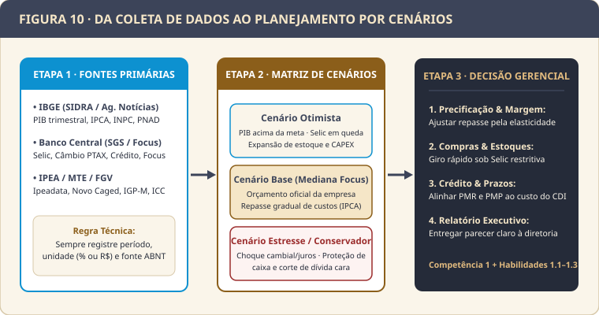

# 10 · Coleta de Dados Econômicos, Análise de Cenários e Planejamento Empresarial

[BENTO_INICIO]
- **Trilha Etária:** Técnico Modular · Jovens Adultos (19 a 21 anos)
- **Competência (Bloom):** Coletar e validar séries econômicas de fontes oficiais, projetar cenários Otimista, Base e Estresse e apresentar relatório executivo de planejamento empresarial.
- **Carga Horária:** 5 horas-aula · 2 encontros de 150 min (Aulas 19 e 20)
- **Entregável de Portfólio:** Relatório Executivo e Matriz Integrada de Cenários Econômicos (Projeto Integrador Final)
[BENTO_FIM]

## 1. O Desafio de Pedro (Assistente Júnior — 20 anos)

Pedro chega ao encerramento do ciclo orçamentário em uma **empresa comercial e de serviços técnicos corporativos** com faturamento atual de **R$ 2.000.000,00/ano**, custos variáveis de **60% (`R$ 1.200.000,00`)**, margem de contribuição de **40% (`R$ 800.000,00`)**, custos fixos operacionais de **R$ 550.000,00** e uma dívida bancária de capital de giro de **R$ 400.000,00** atrelada pós-fixada à variação do CDI/Selic.

Para aprovar o orçamento do próximo ano, os sócios entregaram a Pedro uma única planilha baseada em achismo (*"vamos colocar +10% em vendas e deixar o resto igual"*), sem conferir dados do **IBGE**, expectativas do **Relatório Focus** do Banco Central nem planos de contingência caso os juros subam ainda mais.

Como Pedro substitui esse palpite isolado por um processo profissional de **coleta de dados econômicos primários**, elaboração de **três cenários consistentes (Otimista, Base e Estresse)** e entrega de um **relatório econômico executivo** capaz de orientar decisões reais de caixa, preço e endividamento?

---

## 2. Construindo o Conhecimento

### 2.1 Coleta e Auditoria de Fontes Econômicas Primárias no Brasil (Aula 19)

O valor do trabalho de um técnico em Administração não está em repetir manchetes alarmistas de redes sociais, mas em **extrair dados econômicos verificáveis direto das fontes primárias oficiais** e traduzi-los em variáveis orçamentárias concretas (THOMÁZ, 2016; GONÇALVES et al., 2019).

Mapeie no seu repertório profissional os **cinco repositórios primários essenciais do Brasil**:

| Portal / Sistema Oficial | Instituição | Principais Séries Coletadas | Como Usar no Planejamento Empresarial |
| :--- | :---: | :--- | :--- |
| **SIDRA / Agência IBGE** | **IBGE** | PIB trimestral e anual (`C, I, G, X-M`), IPCA, INPC, Pesquisa Mensal de Comércio (**PMC**), Serviços (**PMS**), **PNAD Contínua** (emprego e renda) | Calibrar crescimento realista da demanda do seu setor e revisar reajustes de folha/aluguel |
| **SGS / Relatório Focus** | **Banco Central (BCB)** | Taxa Selic Meta/Over, CDI, Dólar PTAX, Endividamento das Famílias, Medianas **Focus** (IPCA, PIB, Câmbio e Selic projetados) | Projetar custo financeiro do capital de giro, orçamento de insumos dolarizados e juros reais |
| **Ipeadata** | **IPEA** | Séries macroeconômicas históricas consolidadas (salário mínimo real, câmbio real, carga tributária, indicadores regionais) | Comparar ciclos longos e evitar extrapolar picos atípicos como tendência permanente |
| **Novo CAGED / Painel MTE** | **Min. do Trabalho** | Saldo líquido mensal de admissões e desligamentos formais por município e CNAE | Avaliar aquecimento do mercado de trabalho local e disponibilidade de mão de obra |
| **Sondagens FGV IBRE** | **FGV** | **IGP-M**, Índice de Confiança do Consumidor (**ICC**) e do Empresário, nível de utilização da capacidade instalada (**NUCI**) | Antecipar mudanças de humor antes de fecharem balanços trimestrais do PIB |

Ao registrar qualquer série econômica coletada para um relatório interno, adote o **Protocolo de Auditoria em 4 Checagens**:
1. **Unidade e Base:** verifique se o dado é **variação mensal (%)**, **acumulado em 12 meses (%)**, **número-índice** ou **valor em R$ correntes/constantes**. Nunca misture acumulado anual com mensal!
2. **Abrangência:** verifique se a série reflete o Brasil inteiro, seu Estado ou apenas uma Região Metropolitana (ex.: IPC-FIPE é só município de São Paulo; IPCA abrange 16 regiões).
3. **Ajuste Sazonal:** na comparação de um trimestre com o anterior (ex.: 4º trimestre contra 3º trimestre, que tem efeito de Natal e férias), utilize séries **com ajuste sazonal**; ao comparar dezembro deste ano com dezembro do ano passado, use variação interanual.
4. **Rastreabilidade ABNT:** anote sempre órgão emissor, título da série/tabela, período exato de referência e endereço oficial de consulta.

> 📖 **GLOSSÁRIO**
> **Relatório Focus (BCB):** pesquisa semanal divulgada pelo Banco Central reunindo as medianas das projeções de mais de uma centena de bancos, consultorias e gestores de mercado para IPCA, PIB, Selic e Câmbio nos próximos anos.
> **Cenário Base:** trajetória considerada mais provável segundo o consenso técnico e as variáveis macroeconômicas vigentes no momento da elaboração do orçamento.

> ⚠️ **ATENÇÃO**
> Nunca copie projeções econômicas de blogs não auditados ou apresente números sem período de competência (*"PIB de 2024"* é radicalmente distinto de *"expectativa para 2027"*). Confundir mediana de expectativa **Focus** com dado já realizado pelo **IBGE** invalida a credibilidade de qualquer relatório executivo!

> 🛠️ **PARA PRATICAR**
> Consulte a tabela de fontes acima e defina qual repositório brasileiro oficial (IBGE/SIDRA, BCB/Focus, BCB/SGS, Novo CAGED ou FGV/IBRE) você abriria primeiro para responder a cada pergunta de diretoria: *(1)* "Qual a expectativa de mercado para a Selic no fim do próximo ano?"; *(2)* "O varejo de móveis e eletrodomésticos no estado cresceu ou encolheu em volume no último ano?"; *(3)* "A indústria da nossa cidade contratou ou demitiu com carteira assinada neste trimestre?".

### 2.2 Construção de Matriz de Cenários e Integração ao Orçamento (Aula 20)

O futuro econômico não comporta previsão exata única. Por isso, grandes empresas substituem a projeção rígida única pelo **Planejamento por Cenários**, estruturado em três cenários internamente coerentes (GONÇALVES et al., 2019; MOCHRIE, 2025):

1. **Cenário Otimista (Expansão):** combina demanda forte (PIB acima da mediana), alívio inflacionário e queda gradual de juros — exige plano pronto para acelerar compras e equipe sem perder qualidade.
2. **Cenário Base / Realista (Orçamento Oficial):** ancorado nas medianas do **Relatório Focus** e dados correntes do **IBGE/CAGED** — guia as metas de vendas, tabela de preços e contratações padrão.
3. **Cenário Estresse / Conservador (Contingência):** antecipa choques adversos (alta cambial, inflação persistente, Selic mais alta e compressão de consumo **C**) — estabelece gatilhos prévios de corte de despesas fixas, encurtamento de estoques e amortização de dívida pós-fixada antes que falte liquidez.

Acompanhe como Pedro traduz variáveis macroeconômicas diretamente em **DRE Orçamentária Projetada** (com os dados da empresa do Desafio, considerando receita atual de **R$ 2.000.000,00** e dívida de **R$ 400.000,00** no CDI):

| Linha do Orçamento / Premissa | Cenário Otimista (25%) | Cenário Base — Focus (55%) | Cenário Estresse (20%) |
| :--- | :---: | :---: | :---: |
| **Premissa Macro (PIB / Selic / IPCA)** | PIB +3,2% · Selic 11,0% · IPCA 3,8% | PIB +2,0% · Selic 14,5% · IPCA 4,3% | PIB +0,4% · Selic 16,5% · IPCA 6,0% |
| **Receita Operacional Projetada** | **R$ 2.240.000,00** | **R$ 2.120.000,00** | **R$ 1.960.000,00** |
| **Margem de Contribuição (% e R$)** | `41%` = **R$ 918.400,00** | `40%` = **R$ 848.000,00** | `37%` = **R$ 725.200,00** |
| **Custos Fixos Operacionais** | `-R$ 570.900,00` | `-R$ 573.650,00` | `-R$ 583.000,00` |
| **Despesa Financeira (Dívida R$ 400 mil × Selic)** | `-R$ 44.000,00` | `-R$ 58.000,00` | `-R$ 66.000,00` |
| **Resultado Antes do IR (LAIR)** | **R$ 303.500,00** | **R$ 216.350,00** | **R$ 76.200,00** |

Calcule também o **Valor Esperado Ponderado** dessa matriz para fins de planejamento de caixa:

`E(LAIR) = (0,25 × 303.500) + (0,55 × 216.350) + (0,20 × 76.200) = 75.875 + 118.992,50 + 15.240 =` **`R$ 210.107,50`**

Perceba a clareza estratégica que essa matriz entrega: enquanto a empresa faturaria bem no Cenário Otimista, no **Cenário Estresse** a combinação de demanda fraca (`MC` cai para 37%) com juros maiores (`R$ 66 mil` só de dívida) **esmaga o lucro de R$ 250 mil atual para R$ 76,2 mil**! Logo, amortizar parte dos **R$ 400.000,00** de dívida indexada ao CDI usando saldo ocioso torna a empresa resiliente em qualquer cenário futuro.

### 2.3 Como Apresentar Relatórios e Pesquisas Econômicas (Habilidade 1.3)

Coletar dados precisos só gera impacto quando você sabe apresentá-los em linguagem executiva clara para gerentes e empresários. Estruture qualquer **Relatório Econômico Empresarial** em **cinco blocos objetivos**:
1. **Sumário Executivo (máx. 6 linhas):** responda primeiro à decisão central (*"Recomendamos manter o estoque enxuto e reduzir R$ 150 mil de dívida no CDI antes do próximo trimestre"*).
2. **Contexto Macroeconômico Auditado:** 3 a 5 indicadores-chave (PIB/Consumo, IPCA, Selic/CDI, Câmbio, Emprego local) com tabela comparativa e fontes primárias datadas.
3. **Efeito Microeconômico no Negócio:** elasticidade da carteira, riscos de custo marginal, comportamento de concorrentes e insumos dolarizados.
4. **Matriz de Cenários (Otimista / Base / Estresse):** números verificados de receita, margem, custo financeiro e lucro líquido.
5. **Plano de Ação com Gatilhos:** o que a empresa executa hoje no Cenário Base e qual "sinal amarelo" dispara automaticamente medidas do Cenário Estresse.

> 💡 **SAIBA MAIS**
> Profissionais de Administração recém-formados que dominam a leitura direta de bases públicas (**SIDRA/IBGE** e **SGS/BCB**) economizam tempo das gerências, previnem projeções comerciais irreais e ganham protagonismo imediato em reuniões de orçamento, compras estratégicas e renegociação bancária.

> ❓ **REFLITA**
> Por que definir "gatilhos objetivos" antecipados (ex.: *"se a Selic superar X% ou o giro cair abaixo de Y dias, congelar contratações fixas"*) torna a gestão empresarial mais calma e racional durante crises econômicas?

> 🎬 **MÍDIAS INTEGRADAS**
> Conclua sua prática interativa em **`html/aula-19.html`** (Painel de Leitura Focus/IBGE & Auditoria de Séries) e **`html/aula-20.html`** (Construtor Integrador de Matriz de Cenários Econômicos & Simulador de Orçamento Empresarial).

---

## 3. Síntese — Pedro em Ação

> 🚀 **SÍNTESE — PEDRO EM AÇÃO**
> Pedro substituiu a planilha baseada em palpite de "+10% automático" por um **Relatório Executivo com Matriz de Cenários** ancorado nos dados do IBGE e do Relatório Focus:
> - **Consequência numérica demonstrada:** no **Cenário Base (`55%`)**, mesmo crescendo nominalmente para R$ 2,12 milhões, a combinação de inflação nos fixos (`R$ 573,65 mil`) e juros altos (`R$ 58 mil`) reduz o lucro atual de **R$ 250.000,00** para **R$ 216.350,00**; no **Cenário Estresse (`20%`)**, o resultado desabaria para **R$ 76.200,00**.
> - **Decisão aprovada pela diretoria:** usar caixa de reserva de curto prazo para amortizar **R$ 150.000,00** da dívida atrelada ao CDI (economizando cerca de **R$ 21,7 mil a R$ 24,7 mil/ano em juros** nos cenários Base e Estresse), adotar meta comercial realista ligada ao Focus e acompanhar mensalmente IPCA e PMC/IBGE como gatilhos de reposição de estoque.

---

## 4. Desafio de Portfólio Profissional (Projeto Integrador Final)

Consolide o aprendizado de toda a disciplina em um **Relatório Econômico de Cenários (2 a 3 páginas)**:
1. **Escolha** uma empresa real de pequeno ou médio porte (ou o empreendimento onde atua) e defina seu segmento (Comércio, Indústria, Logística ou Serviços).
2. **Colete** ao menos 4 indicadores econômicos oficiais atuais ou históricos documentados (PIB/Setor no IBGE, IPCA/IGP-M, Selic/BCB e saldo Caged/Emprego) registrando fonte completa em ABNT.
3. **Monte** a Matriz de Cenários (**Otimista / Base / Estresse**) projetando impacto em faturamento, custo dos insumos, juros sobre capital de giro e resultado operacional.
4. **Finalize** a lista [`exercícios/L10-coleta-dados-cenarios-e-planejamento.md`](../exercícios/L10-coleta-dados-cenarios-e-planejamento.md) e revise os cinco estudos de caso reais em [`estudo-de-caso/`](../estudo-de-caso/README.md).

[PROFESSOR_INICIO]
Orientação docente (Aulas 19 e 20 — 150 min cada):
- Na Aula 19, oriente os alunos ao vivo com `html/aula-19.html` sobre a anatomia de um número econômico confiável (unidade, periodicidade, base territorial e fonte primária).
- Na Aula 20 (Seminário Integrador Final), utilize `html/aula-20.html` para que grupos de 3–4 alunos defendam oralmente em 5 minutos suas decisões de cenários diante de um "Conselho Diretor" formado pela turma!
- Gabarito do boxe "Para Praticar": (1) BCB — Relatório Focus; (2) IBGE — Pesquisa Mensal de Comércio (PMC / SIDRA); (3) Ministério do Trabalho e Emprego — Novo CAGED.
[PROFESSOR_FIM]

---

## 5. Referências

BANCO CENTRAL DO BRASIL (BCB). **Sistema Gerenciador de Séries Temporais (SGS) e Relatório Focus**. Brasília: BCB, 2026. Disponível em: https://www.bcb.gov.br/. Acesso em: 15 nov. 2026.

GONÇALVES, Robson Ribeiro et al. **Cenários econômicos e tendências**. Rio de Janeiro: Editora FGV, 2019.

INSTITUTO BRASILEIRO DE GEOGRAFIA E ESTATÍSTICA (IBGE). **Sistema IBGE de Recuperação Automática (SIDRA) e Agência de Notícias**. Rio de Janeiro: IBGE, 2026. Disponível em: https://agenciadenoticias.ibge.gov.br/. Acesso em: 15 nov. 2026.

MOCHRIE, Robbie. **Como pensar como um economista**. São Paulo: Astral Cultural, 2025.

THOMÁZ, André de Faria. **Indicadores econômicos e financeiros**. Indaial: UNIASSELVI, 2016.

---
[← 09 · Política Econômica e Setor Externo](09-politica-economica-e-setor-externo.md) · [Voltar ao Índice da Disciplina →](../README.md)
